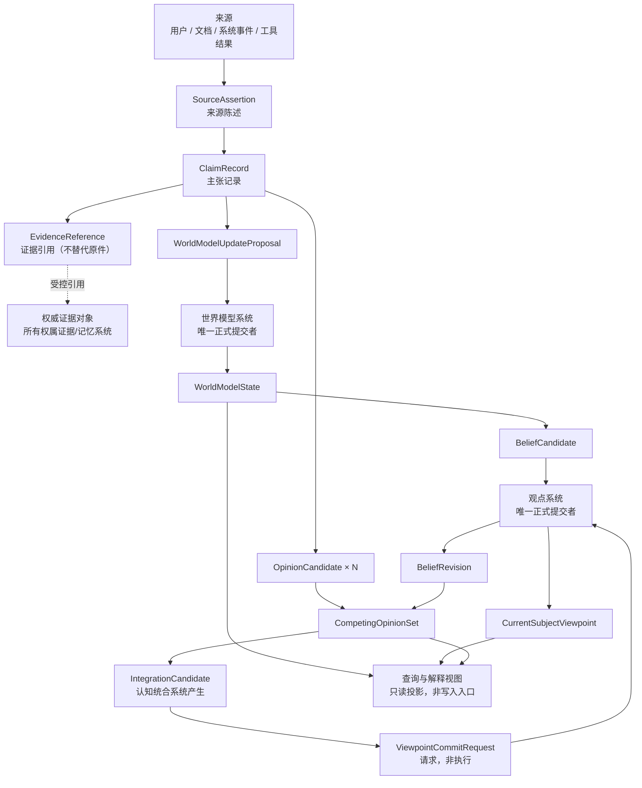
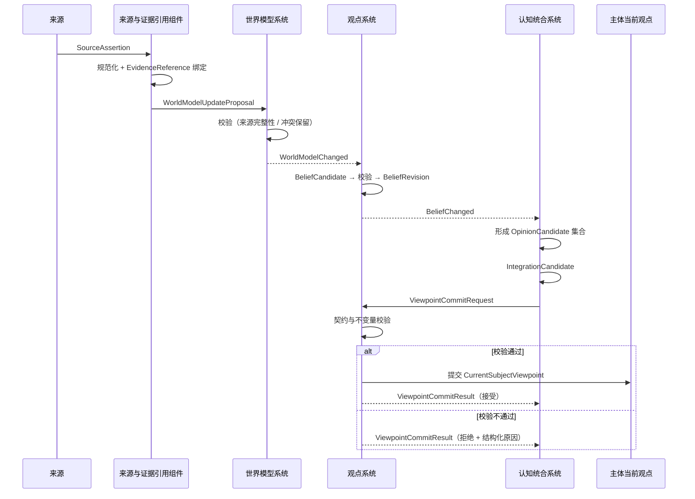
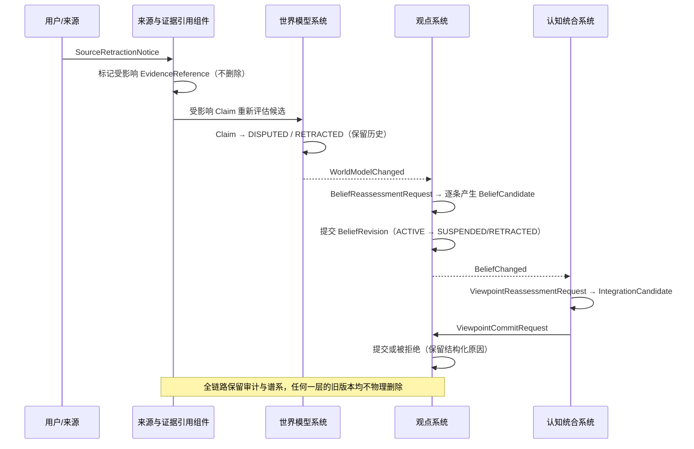

# AI-PSI 世界模型与观点蓝皮书

**关于世界表示、主张、证据、信念、观点与主体当前立场的专项架构设计**

---

## 文档属性

| 属性 | 内容 |
|------|------|
| 文档版本 | World Model & Viewpoint Blueprint v1.0 Candidate |
| 文档状态 | 世界模型与观点专项架构候选基线 |
| 所属项目 | AI-PSI |
| 上位白皮书 | Whitepaper v1.0 |
| 白皮书基线提交 | 21d72cb31eb920681b1c06e13a99384179c89629 |
| 白皮书基线标签 | ai-psi-whitepaper-v1.0 |
| 上位总体架构 | Architecture Blueprint v1.0 Candidate |
| 总体架构基线提交 | b7cbb448bf06ffa86c4577823f65d74f9eee4725 |
| 文档日期 | 2026-09-23 |
| 批准状态 | 待审查 |
| 适用范围 | 世界模型、观点、信念、竞争观点统合及其边界契约 |

### 文档声明

本文件是《AI-PSI 世界模型与观点蓝皮书》**v1.0 Candidate**，属于**专项架构候选稿**，不是正式批准版本。

1. 本文描述**目标架构与设计约束**，不表示相关能力已经全部实现。
2. 本文受 **Whitepaper v1.0** 与**总体架构候选基线**约束，不得静默改变上位文档中的项目定位、四平面边界、状态所有权和治理原则。
3. 本文不对**意识、主观体验或人格**作任何本体论声明。
4. 本文中的"**世界模型**"是 AI-PSI 主体对世界的**可修订内部表示**，不等同于客观世界本身。
5. 本文中的"**信念**"和"**观点**"均属于**可追踪、可修订的工程状态**，不表示不可改变的真理。
6. 文中**第一阶段范围**表示建议实现切片，不表示代码已经存在。
7. 本文不定义字段级 Schema、数据库结构、模型供应商或部署拓扑。

### 术语与既有名称映射

仓库实现层（`src/ai_psi/domain/`）已经存在若干同义或近义类型。按"**优先复用既有名称，必须引入新名称时给出映射**"的规则，列出映射如下。

| 本文逻辑名称 | 既有实现 | 关系 |
|---|---|---|
| Belief（信念） | `domain/beliefs.py::Belief` | **直接复用**。既有字段（`statement` / `supporting_evidence_ids` / `opposing_evidence_ids` / `applicability` / `confidence_band` / `confidence_basis` / `valid_from` / `valid_until` / `revision_conditions` / `supersedes_id`）与本文第七篇的逻辑内容一致 |
| Evidence（证据） | `domain/evidence.py::Evidence` | **直接复用**。既有字段（`source_name` / `source_uri` / `content_summary` / `reliability` / `directness` / `freshness` / `independence_group`）与本文第六篇一致 |
| 置信表达 | `domain/enums.py::ConfidenceBand`、`OrdinalLevel` | **直接复用**。既有实现明确"**不是百分比**"，与本文第十四篇第 14 条不变量一致 |
| 来源类型 | `domain/enums.py::SourceType` | **直接复用**（`USER_MESSAGE` / `EXTERNAL_DOC` / `SYSTEM_EVENT` / `TOOL_RESULT`） |
| 证据直接程度 | `domain/enums.py::EvidenceDirectness` | **直接复用**（`DIRECT` / `INDIRECT` / `INFERRED` / `HEARSAY`） |
| 不确定性种类 | `domain/enums.py::UncertaintyType` | **直接复用**（`ALETHIC` / `EPISTEMIC` / `LINGUISTIC` / `ONTOLOGICAL` / `NORMATIVE`） |
| 同源证据识别 | `Evidence.independence_group` | **直接复用**。该字段即本文第十六篇失败模式 10 与第六篇关系 7 所要求的机制 |
| 外部主张 | 总体架构 8.1 `ExternalClaim` | **上位同名**。本文的 `ClaimRecord` 是规范化后的世界模型侧记录，二者为**上下游关系**，不是同一对象的两个名字 |
| 证据对象 | 总体架构 8.1 `Evidence` | **上位同名**。本文的 `EvidenceReference` 是**指向**证据对象的受控引用，不替代证据对象（见第六篇关系 4） |
| 治理证据包与判定 | `evaluation/` 中 `EvidenceBundle` / `GateDecision` / `QualificationDecision` | **边界相邻、职责不同**。它们属于**治理平面**对候选变化的判定产物，不属于认知平面的世界模型；本文不修改、不复制、不重定义它们 |

> **映射结论**：本蓝皮书**新增**的逻辑名称仅限世界模型、主张记录、观点、竞争观点集合、统合候选、主体当前观点及其修订/提交契约与事件；其余概念一律复用既有名称。

### 概念边界速查

| 概念 | 一句话边界 |
|------|------------|
| 世界模型 | 主体对世界的可修订内部表示，不等于客观现实 |
| Claim（主张） | 可被支持、反驳、限定、撤回或暂缓判断的命题性表达，**不是事实** |
| Source Assertion（来源陈述） | 某个来源作出的陈述，**不因被记录而成为主体信念** |
| Evidence Reference（证据引用） | 指向权威证据对象的受控引用，**不是证据原件** |
| Belief（信念） | 主体对某主张的认识性承诺，带范围、依据、不确定性与生命周期 |
| Opinion（观点） | 主体对某问题/主题/决策对象的综合立场，可综合多个信念 |
| Opinion Candidate（观点候选） | 尚未提交的立场候选，**不等于**主体当前观点 |
| Current Subject Viewpoint（主体当前观点） | 观点系统正式提交的当前立场，可明确为未决定 |
| Competing Opinions（竞争观点） | 同一观点键下并存的多个候选，**允许共存且不被删除** |
| Integration Candidate（统合候选） | 认知统合系统产生的统合结果候选，**不等于正式提交** |
| Viewpoint Lineage（观点谱系） | 观点与信念的修订继承关系，回滚不删除历史 |

---

## 第一篇：目标、范围与非目标

### 1.1 本蓝皮书负责

1. 世界模型的**逻辑表示**；
2. 世界模型**更新候选与正式提交边界**；
3. **主张与证据引用**关系；
4. **信念与观点的概念区分**；
5. **主体当前观点的形成与提交**；
6. **竞争观点的共存、比较与统合**；
7. 观点与信念的**修订谱系**；
8. 与外部系统的**契约边界**；
9. **第一阶段最小可实现切片**。

### 1.2 本蓝皮书不负责

下列内容**不由本文解决**，分别归属后续专项或治理阶段：

| # | 不负责的内容 | 归属 |
|---|--------------|------|
| 1 | 完整认知循环调度 | P3《认知运行蓝皮书》 |
| 2 | Task、Turn、ModelCall 的最终运行时结构 | P3 |
| 3 | 工作记忆与当前认知状态的完整边界 | P3 |
| 4 | 长期记忆晋升策略 | P4《记忆与自我模型蓝皮书》 |
| 5 | 自我模型权威字段 | P4 |
| 6 | 元认知健康评分公式 | P5《元认知与认知稳态蓝皮书》 |
| 7 | 模型供应商选择 | 后续技术选型 |
| 8 | 数据库选型 | 后续技术选型 |
| 9 | 物理部署拓扑 | 后续工程阶段 |
| 10 | 完整权限令牌设计 | 第二批《安全、健康与恢复蓝皮书》 |
| 11 | 结构进化和正式版本晋升 | 第三批《结构进化蓝皮书》《评测与晋升治理蓝皮书》 |
| 12 | 直接修改正式大脑 | **任何阶段均不由本专项承担** |
| 13 | 意识或人格的本体论证明 | **不属于本项目工程目标** |

### 1.3 非目标

本文**不试图**：

- 把世界模型设计成全知知识库或完整外部世界的复制；
- 用单一 `confidence` 数字统一表达来源可信度、证据质量与主体信念；
- 定义竞争观点的最终评分算法或置信度计算公式；
- 让任何认知角色或语言模型直接写入主体当前观点；
- 用世界模型取代长期记忆、当前认知状态或自我模型；
- 通过删除冲突项来制造表面一致。

---

## 第二篇：术语与概念边界

### 2.1 术语定义表

| # | 术语 | 定义 |
|---|------|------|
| 1 | 世界模型（World Model） | 主体用于组织实体、关系、事件、状态、主张及其时间和来源关系的**可修订内部表示** |
| 2 | 世界模型状态（World Model State） | 某一时刻由世界模型系统正式提交的、对当前世界表示的整体状态 |
| 3 | 实体（Entity） | 世界模型中具有稳定身份的指称对象 |
| 4 | 关系（Relation） | 实体之间、实体与事件之间具有范围和有效期的结构化关联 |
| 5 | 事件（Event） | 在时间上发生、可被指称和引用的事项 |
| 6 | 主张（Claim） | 可被支持、反驳、限定、撤回或暂缓判断的**命题性表达** |
| 7 | 来源陈述（Source Assertion） | 某个**来源**作出的陈述，是主张的原始输入形态 |
| 8 | 证据引用（Evidence Reference） | 指向权威证据对象的**受控引用**，含引用必要的摘要与角色信息 |
| 9 | 来源（Source） | 产生来源陈述的主体或系统（用户、外部文档、系统事件、工具结果等） |
| 10 | 信念（Belief） | 主体对某主张所持的、具有范围、依据、不确定性和生命周期的**认识性承诺** |
| 11 | 观点（Opinion） | 主体针对某问题、主题或决策对象形成的**综合立场** |
| 12 | 观点候选（Opinion Candidate） | 尚未经观点系统提交的立场候选 |
| 13 | 主体当前观点（Current Subject Viewpoint） | 观点系统**正式提交**的、主体在特定观点键、范围与上下文下当前采用的正式立场 |
| 14 | 竞争观点（Competing Opinions） | 同一观点键下并存的多个候选立场 |
| 15 | 统合候选（Integration Candidate） | 认知统合系统产生的统合结果候选，**不直接构成正式立场** |
| 16 | 观点谱系（Viewpoint Lineage） | 观点与信念的修订、取代与撤回所构成的继承关系 |
| 17 | 置信表达（Confidence Expression） | 对主张置信、信念承诺强度或观点稳定程度的**结构化**表达 |
| 18 | 不确定（Uncertain） | 已形成判断，但判断本身带有明确的、可声明的不可靠程度 |
| 19 | 未知（Unknown） | 主体**尚未掌握**相关信息的状态，**不是否定** |
| 20 | 未决定（Undetermined） | 主体已识别问题、但**明确选择暂不形成立场**或信息不足以形成立场的结构化状态 |
| 21 | 冲突（Conflict） | 两个或多个对象之间在真值、范围、时间或来源上不相容的状态 |
| 22 | 撤回（Retraction） | 声明某对象不再作为有效依据或承诺，**保留历史**的状态迁移 |
| 23 | 取代（Supersession） | 以新版本接替旧版本，**必须指向后继版本**且保留前序历史 |
| 24 | 时间有效性（Temporal Validity） | 对象在时间维度上的生效与失效范围 |
| 25 | 认知状态（Cognitive State） | **上位术语**。由认知运行系统拥有的完整当前认知状态；本文只定义其中与世界模型、信念和观点相关的接口部分 |

### 2.2 世界模型

世界模型是主体用于组织实体、关系、事件、状态、主张及其时间和来源关系的可修订内部表示。

世界模型**不等于**：

- 外部现实本身；
- 一组不可修改的事实；
- 大语言模型参数；
- 长期记忆的同义词；
- 主体当前观点的同义词。

### 2.3 主张

主张是可被支持、反驳、限定、撤回或暂缓判断的命题性表达。

主张**不因被写入世界模型**就自动成为：

- 客观事实；
- 已接受信念；
- 正式观点。

### 2.4 信念

信念是主体对某个主张所持的、具有范围、依据、不确定性和生命周期的认识性承诺。

信念通常回答：

- 主体目前把什么当作可信；
- 在什么范围内可信；
- 依据是什么；
- 不确定程度如何；
- 什么证据可能使其修订。

信念**不得**定义为"模型曾生成过的文本"。

### 2.5 观点

观点是主体针对某个问题、主题或决策对象形成的综合立场。

观点可以综合：

- 一个或多个信念；
- 证据状态；
- 价值约束；
- 目标和上下文；
- 不确定性；
- 竞争解释。

观点**不等于**单个事实主张，也**不等于**单个信念。

### 2.6 主体当前观点

主体当前观点是观点系统正式提交的、主体在特定主题与上下文下当前采用的正式立场。

必须强调：

- "当前"按**观点键、主题、范围和上下文**确定；
- 不表示整个主体在任何问题上只能有一个观点；
- **不允许认知统合系统直接覆盖**；
- 必须保留来源、依据和修订谱系；
- 可以明确记录"**未决定**"或"**暂不形成观点**"。

### 2.7 Opinion 与 Belief 的关系

| 维度 | Belief（信念） | Opinion（观点） |
|------|----------------|-----------------|
| 对象 | 单个**主张** | 一个问题、主题或决策对象 |
| 性质 | 对命题真值或可信程度的**认识性承诺** | 对问题或主题的**综合立场** |
| 可否含规范性成分 | **不应**承载未说明的偏好 | **可以**包含规范性、偏好性或决策性成分 |
| 引用关系 | 被多个 Opinion 引用 | 可引用多个 Belief（多对多） |
| 生命周期 | 见第七篇 | 见第八篇、第十一篇 |
| 逻辑所有者 | 观点系统 | 观点系统 |

**二者不能被当作同一张无差别记录表的两个名称。**具体物理存储可以共享基础设施，但**逻辑语义必须分离**。

---

## 第三篇：设计原则与核心不变量

以下不变量在本专项范围内**必须成立**，任何实现不得绕过。

| # | 不变量 |
|---|--------|
| 1 | 模型输出不等于事实 |
| 2 | 来源陈述不等于主体信念 |
| 3 | 写入世界模型不等于接受为信念 |
| 4 | 信念不等于观点 |
| 5 | 观点候选不等于主体当前观点 |
| 6 | 统合候选不等于正式提交 |
| 7 | 当前观点变化必须可追踪 |
| 8 | 正式状态不得被无痕覆盖 |
| 9 | 相互冲突的候选可以共存 |
| 10 | 未知不得伪装为否定 |
| 11 | 未决定不得伪装为低置信肯定 |
| 12 | 缺少证据不得自动成为反证 |
| 13 | 来源数量不得简单等同于证据强度 |
| 14 | 置信表达不得伪装成未经校准的精确概率 |
| 15 | 被撤回的来源不得从历史中物理消失 |
| 16 | 时间变化不得被误判为逻辑矛盾 |
| 17 | 观点系统是观点与信念谱系的逻辑所有者 |
| 18 | 认知统合系统只产生统合候选 |
| 19 | 认知运行系统拥有完整当前认知状态 |
| 20 | 世界模型系统不得成为当前认知状态的第二所有者 |
| 21 | 世界模型中的引用不得复制并冒充外部证据原件 |
| 22 | 任何正式提交都必须有可审计身份、原因和前序状态 |
| 23 | 回滚不得删除已发生的谱系 |
| 24 | 查询视图不得反向成为绕过提交规则的写入口 |

### 3.1 提交边界原则

所有**正式状态变化**必须满足：

```
提议者  ≠  正式提交者  （可以相同，但必须显式区分角色）
正式提交者  =  该权威状态的逻辑所有者
候选  ≠  正式状态
事件  ≠  命令
```

### 3.2 上位一致性

本文**不得**推翻或静默修改上位结论：认知运行系统拥有当前认知状态；观点系统拥有观点与信念谱系；观点系统提交主体当前观点；认知统合系统只产生统合候选；治理平面负责判定与授权；控制平面负责验证与执行；Watchdog 不参与认知；正式、影子和候选大脑职责分离；主体连续性优先于无约束优化；候选变化不得直接修改正式大脑；所有正式变化必须可审计；长期目标不等于当前已实现能力。

---

## 第四篇：总体逻辑架构

### 4.1 逻辑组件

| # | 组件 | 主要职责 |
|---|------|----------|
| 1 | 世界模型系统 | 拥有世界模型状态；校验并正式提交 `WorldModelRevision` |
| 2 | 主张管理组件 | 主张记录的身份、规范化、冲突与状态维护 |
| 3 | 来源与证据引用组件 | 来源登记、`SourceAssertion` 接收、`EvidenceReference` 绑定与撤回传播 |
| 4 | 观点系统 | 拥有信念谱系与观点谱系；正式提交 `BeliefRevision` 与 `CurrentSubjectViewpoint` |
| 5 | 信念生命周期组件 | 信念状态迁移、依据校验、修订与取代 |
| 6 | 竞争观点集合 | 同一观点键下多候选的共存、比较与保留 |
| 7 | 认知统合系统 | 产生 `IntegrationCandidate`；**不提交正式观点** |
| 8 | 观点提交组件 | `ViewpointCommitRequest` 的契约与不变量校验、提交或结构化拒绝 |
| 9 | 谱系与审计组件 | 修订链、拒绝原因、撤回范围的追加式记录 |
| 10 | 查询与解释视图 | 按时间与上下文投影的**只读**视图 |
| 11 | 与认知运行系统的接口 | 当前观点在认知状态中的引用边界 |
| 12 | 与记忆系统的接口 | 证据对象与记忆对象的引用边界 |
| 13 | 与元认知系统的接口 | 偏见信号触发重新评估的入口 |
| 14 | 与治理系统的接口 | 候选变化判定所需证据的只读出口 |

### 4.2 架构约束

- 逻辑组件**不代表**必须部署为独立服务；
- **不要求**为每个逻辑组件创建 Python 类；
- 本文定义**逻辑职责与契约**，不决定物理部署；
- **证据原件的权威所有者可能位于证据或记忆系统**，不在本文主张；
- 世界模型只保存**受控引用和必要摘要**，不抢夺其他系统的所有权。

### 4.3 逻辑关系图



**图 1 · 世界模型与观点逻辑关系**

图中不出现把 LLM、Agent、认知统合系统或查询视图画成 `CurrentSubjectViewpoint` 直接写入者的连线：`IntegrationCandidate` 只能经 `ViewpointCommitRequest` 到达**观点系统**，由观点系统提交。

### 4.4 与上位总体架构的关系

本文的组件映射到总体架构的逻辑组件：

| 本文组件 | 上位总体架构对应 |
|---|---|
| 世界模型系统 | 5.3 世界模型系统 |
| 来源与证据引用组件 | 5.4 证据与来源系统 |
| 观点系统 / 信念生命周期组件 | 5.5 观点与信念系统 |
| 认知统合系统 | 5.12 认知统合系统 |
| 观点提交组件 | 5.5 观点与信念系统的提交面 |
| 谱系与审计组件 | 6.2 审计记录 / 版本谱系 |

本文**不新增平面**，全部组件均属**认知平面**；与治理平面的交互仅为只读出口。
---

## 第五篇：世界模型

### 5.1 世界模型必须能表达的内容

| # | 能力 | 说明 |
|---|------|------|
| 1 | 实体及稳定身份 | 实体有稳定标识，不随表述变化而重建 |
| 2 | 实体别名和身份不确定性 | 同一实体的多个称法、以及"是否同一实体"的未决状态 |
| 3 | 关系及关系范围 | 关系带范围与有效期，不默认全局成立 |
| 4 | 事件及时间信息 | 事件的发生时间与记录时间分离 |
| 5 | 状态及其有效时间 | 状态是带有效期的断言，不是永久属性 |
| 6 | 主张及其支持或反驳关系 | 支持/反驳/限定/关联四类关系 |
| 7 | 来源和证据引用 | 受控引用，不复制原件 |
| 8 | 相互冲突的主张 | 冲突项并存，不强行消解 |
| 9 | 假设性内容 | 明确标记为假设 |
| 10 | 反事实或模拟内容 | 与实际观察严格区分 |
| 11 | 来源陈述与主体承诺的区别 | 二者不可混同 |
| 12 | 撤回、取代和修订 | 保留历史，不物理删除 |
| 13 | 查询时的时间和上下文范围 | 查询结果必须声明其时间与上下文 |

### 5.2 世界模型内容类型

世界模型中的每一条记录**必须**归属于下列内容类型之一。**不得把所有记录统一称为"事实"。**

| 内容类型 | 含义 | 是否构成主体承诺 |
|----------|------|------------------|
| 观察或来源陈述 | 直接观察或某来源作出的陈述 | **否** |
| 主张 | 已规范化的命题性表达 | **否** |
| 假设 | 为推进推理暂时采用的前提 | **否** |
| 已接受但可修订的模型项 | 已被主体接受的模型内容 | **是**（经由信念，不直接） |
| 冲突项 | 与其他记录不相容的记录 | **否** |
| 已撤回项 | 声明不再作为有效依据的记录 | **否** |
| 已取代项 | 被后继版本接替的记录 | **否** |
| 反事实或模拟项 | 反事实推演或模拟产生的内容 | **否** |

> **"已接受但可修订的模型项"不等于信念。**世界模型中的接受是**表示层面**的接受；
> 主体的认识性承诺由**信念**承载，并由观点系统提交。

### 5.3 世界模型的关键边界

1. 世界模型**可以保存尚未被主体接受的主张**；
2. 世界模型更新**可以改变**主体可用的世界表示；
3. 世界模型更新**不会自动修改**主体当前观点；
4. 世界模型提交者**必须**是世界模型系统；
5. 其他模块只能提交 `WorldModelUpdateProposal` 或等价候选；
6. 世界模型系统与观点系统之间通过**明确事件或契约**交互，不共享可变全局状态。

---

## 第六篇：主张、证据与来源

### 6.1 关系定义

1. **Source** 提供 **Source Assertion**；
2. **Source Assertion** 可以规范化为一个或多个 **Claim**；
3. **Claim** 可以引用零个、一个或多个 **Evidence Reference**；
4. **Evidence Reference** 指向权威证据对象，**不替代证据对象**；
5. **Evidence** 可以**支持、反驳、限定或仅关联** Claim；
6. 同一证据可与多个 Claim 相关；
7. 同一 Claim 可由多个**相互独立或相互依赖**的来源支持；
8. 来源相关性**必须可表达**；
9. 来源撤回必须传播为**影响信号**，而不是静默删除下游状态；
10. 证据新增或失效**可以触发**信念和观点重新评估候选；
11. 重新评估候选**不等于**自动提交新观点。

### 6.2 证据引用与证据原件的区分

| 对象 | 所有者 | 说明 |
|------|--------|------|
| 证据原件 | 证据系统或记忆系统 | 权威对象，本文不主张其所有权 |
| `EvidenceReference` | 世界模型（作为引用关系） | 只保存身份引用、角色、适用范围与必要摘要 |

🔴 **不变量 21**：世界模型中的引用**不得复制并冒充外部证据原件**。引用失效时应表现为
"引用不可达"，而不是"引用仍然有效但内容已被替换"。

### 6.3 六个必须分离的维度

| 维度 | 回答的问题 | 归属 |
|------|------------|------|
| 来源可信度 | 这个来源有多可靠 | 来源/证据 |
| 证据质量 | 材料本身有多扎实 | 证据 |
| 证据相关性 | 与当前主张有多相关 | 证据 × 主张 |
| 证据充分性 | 是否足够支撑结论 | 证据集合 |
| 主张置信 | 该主张有多可信 | 主张 |
| 信念承诺强度 | 主体对该主张的承诺程度 | 信念 |
| 观点置信 | 该立场有多稳定 | 观点 |

🔴 **不得把这些维度压缩成一个含义不明的 `confidence` 数字而不作说明。**
具体数值算法不在本任务范围内。

---

## 第七篇：信念模型

### 7.1 Belief 的逻辑内容

下列为**逻辑字段**，不要求直接形成数据库 Schema。

| # | 逻辑字段 | 说明 |
|---|----------|------|
| 1 | 稳定身份 | 跨修订保持不变的对象身份 |
| 2 | 所针对的 Claim | 指向被承诺的主张 |
| 3 | 适用主体 | 该信念是关于谁/什么的 |
| 4 | 适用范围 | **缺少适用范围的信念最危险**——它会被过度推广 |
| 5 | 上下文 | 成立所依赖的上下文 |
| 6 | 时间有效性 | 生效时间与失效时间 |
| 7 | 当前状态 | 见 7.2 生命周期 |
| 8 | 置信表达 | 结构化表达，见第十四篇 |
| 9 | 支持依据引用 | 指向支持证据/依据 |
| 10 | 反驳或削弱依据引用 | 指向反对证据/依据 |
| 11 | 已知限制 | 已知的适用限制 |
| 12 | 潜在反证条件 | 什么证据会使其修订 |
| 13 | 前序版本 | 指向被本版本接替的版本 |
| 14 | 修订原因 | 触发本次修订的原因 |
| 15 | 提议者 | 产生候选的角色 |
| 16 | 正式提交者 | **观点系统** |
| 17 | 审计引用 | 指向审计记录 |

### 7.2 Belief 生命周期

闭合集合（英文标识稳定）：

```
PROPOSED · ACTIVE · SUSPENDED · REJECTED · SUPERSEDED · RETRACTED
```

| 状态 | 含义 | 强调 |
|------|------|------|
| `PROPOSED` | 候选已提出，尚未经观点系统提交 | 不是承诺 |
| `ACTIVE` | 主体当前采用 | **不表示绝对真实** |
| `SUSPENDED` | 暂缓承诺 | **不等于否定** |
| `REJECTED` | 当前不接受该候选 | **不代表命题必然为假** |
| `SUPERSEDED` | 已被后继版本接替 | **必须指向后继版本** |
| `RETRACTED` | 已撤回 | **必须保留历史和撤回原因** |

### 7.3 信念更新规则

- Belief 更新**必须产生新修订或受审计状态迁移**；
- **不允许覆盖后丢失历史依据**；
- 非 `PROPOSED` 状态的信念原则上应有非空依据（与既有实现"必须有依据或明确标记为暂定"一致）。

### 7.4 与既有实现的语义缺口（登记）

既有实现 `BeliefStatus` = `TENTATIVE` / `ACTIVE` / `DISPUTED` / `SUPERSEDED` / `RETRACTED`，与本文六态**不完全对应**：

| 本文状态 | 既有实现 | 差异 |
|----------|----------|------|
| `PROPOSED` | （无直接对应） | 既有 `TENTATIVE` 更接近"已接受但依据不足"，与"尚未提交的候选"语义不同 |
| `ACTIVE` | `ACTIVE` | 一致 |
| `SUSPENDED` | `DISPUTED`（近似） | **语义不同**：`SUSPENDED` 是主体**主动暂缓承诺**；`DISPUTED` 是**存在冲突证据**这一客观状态 |
| `REJECTED` | （无） | 既有无"拒绝"状态 |
| `SUPERSEDED` | `SUPERSEDED` | 一致 |
| `RETRACTED` | `RETRACTED` | 一致 |
| （无对应） | `TENTATIVE` | 本文未设"暂定"独立状态，其语义由 `PROPOSED` + 依据充分性表达 |

**处置**：该差异登记为**未决问题 U-06**与**上位回写候选**，移交 **P9（S1—S8 评审结论导入、版本确认与架构映射）**处理；本文**不修改任何既有实现**。

---

## 第八篇：观点与主体当前观点

### 8.1 Opinion 的逻辑内容

| # | 逻辑字段 | 说明 |
|---|----------|------|
| 1 | 观点身份 | 稳定身份 |
| 2 | 观点键或主题 | 决定"当前观点"的作用域 |
| 3 | 问题定义 | 该观点回答的是什么问题 |
| 4 | 上下文与范围 | 成立所依赖的上下文与范围 |
| 5 | 立场内容 | 结构化立场 |
| 6 | 相关 Belief 引用 | 可引用多个 |
| 7 | 相关 Claim 引用 | 可引用多个 |
| 8 | 价值或目标约束 | 规范性成分须显式声明 |
| 9 | 不确定性 | 结构化表达 |
| 10 | 已知反对意见 | 不得隐藏 |
| 11 | 替代观点引用 | 指向竞争候选 |
| 12 | 形成依据 | 为何形成该立场 |
| 13 | 适用时间 | 时间有效性 |
| 14 | 生命周期状态 | 见第十一篇 |
| 15 | 前序版本 | 修订链 |
| 16 | 修订理由 | 触发原因 |
| 17 | 提议者 | 产生候选的角色 |
| 18 | 正式提交者 | **观点系统** |
| 19 | 审计引用 | 指向审计记录 |

### 8.2 Opinion Candidate

- **可以**由推理、证据、反思、认知统合或其他授权模块提出；
- **不能**直接作为主体当前观点；
- **必须**经过契约校验和观点系统提交。

### 8.3 Current Subject Viewpoint

- 是特定**观点键、范围和上下文**下的当前正式立场；
- **由观点系统提交**；
- 可以引用某个正式 Opinion 修订；
- 可以明确为 `UNDETERMINED`；
- 更新时**必须保留前序状态**；
- **不允许使用最后写入者获胜覆盖冲突**；
- **不允许**认知角色或 LLM 直接写入。

### 8.4 "没有观点"的五种区分

**不得用同一个空值掩盖这些状态。**

| 状态 | 含义 | 表达 |
|------|------|------|
| 尚未建立 | 从未就该观点键形成过任何立场 | `NOT_ESTABLISHED` |
| 信息不足 | 已知存在问题但信息不足以形成立场 | `UNDETERMINED`（原因：信息不足） |
| 竞争未统合 | 存在竞争观点且尚未统合 | `UNDETERMINED`（原因：竞争未统合），并保留竞争集合 |
| 明确暂缓 | 主体明确选择暂缓判断 | `DEFERRED` |
| 已撤回 | 观点曾存在但已撤回 | `RETRACTED`，并保留历史 |

---

## 第九篇：竞争观点与统合

### 9.1 竞争观点处理流程

1. 识别同一观点键下的多个候选；
2. 保留候选**各自依据**；
3. 标注支持和反对关系；
4. 标注**范围、时间和上下文差异**；
5. 识别**表面冲突与真实冲突**；
6. 形成 `IntegrationCandidate`；
7. 执行**契约和不变量校验**；
8. 由**观点系统**提交当前主体观点；
9. **保留未被采用的竞争观点**；
10. 记录采用、拒绝、暂缓或保留并列的**原因**。

### 9.2 统合结果闭合集合

```
ADOPT_ONE · SYNTHESIZE · KEEP_MULTIPLE · DEFER · REJECT_ALL · NO_CHANGE
```

| 结果 | 含义 |
|------|------|
| `ADOPT_ONE` | 采用其中一个候选作为当前立场 |
| `SYNTHESIZE` | 由多个候选综合形成新的立场 |
| `KEEP_MULTIPLE` | 明确保留多个并列立场（例如不同上下文的观点） |
| `DEFER` | 暂缓形成立场 |
| `REJECT_ALL` | 全部候选均不被接受 |
| `NO_CHANGE` | 保持当前立场不变 |

### 9.3 统合的禁止事项

- **不得只按生成时间**选择最新观点；
- **不得只按来源数量**决定胜负；
- **不得只按单一置信数字**机械覆盖；
- **不得删除**未被采用的竞争观点；
- **不得**把不同上下文下的观点强行合并；
- 本文**不定义**最终评分算法。

### 9.4 提交边界

```
统合候选由认知统合系统产生  →  ViewpointCommitRequest  →  观点系统校验并提交
```

- 观点系统**必须**校验统合结果所引用的候选和依据；
- 观点系统**拒绝**非法候选时应产生**结构化拒绝结果**（`ViewpointCommitResult`）；
- 认知统合系统**不得**绕过观点系统提交或覆盖正式立场。

---

## 第十篇：状态所有权与提交权限

### 10.1 所有权矩阵

| 权威状态 | 逻辑所有者 | 可提出修改者 | 正式提交者 | 约束规则 |
|----------|------------|--------------|------------|----------|
| 世界模型状态 | 世界模型系统 | 认知角色、工具结果、证据模块、记忆接口、认知统合系统 | 世界模型系统 | 世界模型更新与来源完整性规则 |
| 实体与关系谱系 | 世界模型系统 | 主张管理组件、来源与证据引用组件 | 世界模型系统 | 实体身份与关系范围规则 |
| 主张记录 | 世界模型系统 | 来源与证据引用组件、推理模块 | 世界模型系统 | 主张规范化与冲突保留规则 |
| 来源与证据引用关系 | 来源与证据引用组件 | 证据模块、工具适配器、用户输入通道 | 来源与证据引用组件 | 来源登记与引用完整性规则 |
| 信念谱系 | 观点系统 | 推理模块、证据模块、反思模块、认知统合系统 | 观点系统 | 信念生命周期与修订规则 |
| 观点谱系 | 观点系统 | 推理模块、证据模块、反思模块、认知统合系统 | 观点系统 | 观点生命周期与修订规则 |
| 主体当前观点 | 观点系统 | 认知统合系统及其他授权候选产生者 | 观点系统 | 当前观点提交规则 |
| 竞争观点集合 | 观点系统 | 推理模块、证据模块、反思模块、认知统合系统 | 观点系统 | 竞争观点保留规则 |
| 统合候选 | 认知统合系统 | 认知统合系统 | 认知统合系统 | 统合候选完整性规则 |
| 查询投影视图 | 查询与解释视图 | （不可修改，派生只读） | （无正式提交者，非权威状态） | 查询投影一致性规则 |
| 审计记录 | 谱系与审计组件 | 所有受控组件 | 追加式审计系统 | 审计完整性和保留规则 |
| 修订谱系 | 谱系与审计组件 | 各权威状态所有者 | 谱系系统 | 谱系一致性规则 |

### 10.2 必须解释的边界

- **统合候选的所有权不意味着认知统合系统拥有正式观点**——它只拥有"候选"这一权威状态；
- **世界模型系统不拥有完整当前认知状态**——当前认知状态由**认知运行系统**拥有（上位结论）；
- **观点系统不拥有工作记忆**——工作记忆的所有权属工作记忆系统；
- **查询视图不是权威写入入口**——它是派生只读投影；
- **审计和谱系系统不能替代业务状态所有者**——它们记录变化，不产生业务状态。

### 10.3 专项细化声明

本文 10.1 对上位总体架构 6.2 的"当前认知状态""观点谱系""主体当前观点"等行做了**下位细化**（增加世界模型、主张、证据引用与统合候选等专项状态）。

**该细化不修改上位文档**，仅作为专项层的展开；如 P6 发现冲突，以上位总体架构为准。

---

## 第十一篇：生命周期与状态迁移

### 11.1 五类生命周期

#### Claim 生命周期

```
PROPOSED · ACTIVE · DISPUTED · SUPERSEDED · RETRACTED
```

#### Belief 生命周期

```
PROPOSED · ACTIVE · SUSPENDED · REJECTED · SUPERSEDED · RETRACTED
```

#### Opinion 生命周期

```
PROPOSED · ACTIVE · SUSPENDED · REJECTED · SUPERSEDED · RETRACTED
```

#### Integration Candidate 生命周期

```
DRAFT · READY_FOR_VALIDATION · VALIDATED · REJECTED · COMMITTED · EXPIRED
```

#### Current Subject Viewpoint 更新生命周期

```
REQUESTED · VALIDATING · COMMITTED · REJECTED · SUPERSEDED
```

> **不要求所有生命周期共享完全相同的状态。**例如 Claim 使用 `DISPUTED` 表示"存在冲突证据"，
> 而 Belief 使用 `SUSPENDED` 表示"主体主动暂缓承诺"——二者**不可互换**。

### 11.2 状态迁移表

| 对象 | 当前状态 | 允许的下一状态 | 触发者 | 正式提交者 | 必要依据 | 禁止条件 |
|------|----------|----------------|--------|------------|----------|----------|
| Claim | `PROPOSED` | `ACTIVE` / `RETRACTED` | 来源与证据引用组件 | 世界模型系统 | 来源与规范化依据 | 无来源的匿名主张 |
| Claim | `ACTIVE` | `DISPUTED` / `SUPERSEDED` / `RETRACTED` | 证据模块 | 世界模型系统 | 冲突证据或后继主张 | 直接物理删除 |
| Claim | `DISPUTED` | `ACTIVE` / `SUPERSEDED` / `RETRACTED` | 证据模块 | 世界模型系统 | 冲突消解或范围区分依据 | 通过隐藏冲突项消解 |
| Belief | `PROPOSED` | `ACTIVE` / `REJECTED` | 推理/证据/反思/统合 | 观点系统 | 依据或明确暂定标记 | 无依据且未标记暂定 |
| Belief | `ACTIVE` | `SUSPENDED` / `SUPERSEDED` / `RETRACTED` | 证据/元认知 | 观点系统 | 新证据或反证条件满足 | 无痕覆盖 |
| Belief | `SUSPENDED` | `ACTIVE` / `RETRACTED` | 证据模块 | 观点系统 | 恢复承诺的依据 | 把暂缓直接记为否定 |
| Opinion | `PROPOSED` | `ACTIVE` / `REJECTED` | 推理/证据/反思/统合 | 观点系统 | 立场与依据 | 候选直接作为当前立场 |
| Opinion | `ACTIVE` | `SUSPENDED` / `SUPERSEDED` / `RETRACTED` | 统合/元认知 | 观点系统 | 修订理由 | 最后写入者获胜 |
| Integration Candidate | `DRAFT` | `READY_FOR_VALIDATION` / `EXPIRED` | 认知统合系统 | 认知统合系统 | 候选集合完整性 | 缺少竞争集合 |
| Integration Candidate | `READY_FOR_VALIDATION` | `VALIDATED` / `REJECTED` | 认知统合系统 | 认知统合系统 | 不变量校验结果 | 跳过校验 |
| Integration Candidate | `VALIDATED` | `COMMITTED` / `EXPIRED` | 观点系统 | 观点系统 | `ViewpointCommitResult` 接受 | 未经观点系统直接生效 |
| CSV 更新 | `REQUESTED` | `VALIDATING` / `REJECTED` | 观点系统 | 观点系统 | 请求与引用完整性 | 请求被当作执行结果 |
| CSV 更新 | `VALIDATING` | `COMMITTED` / `REJECTED` | 观点系统 | 观点系统 | 契约与不变量校验通过 | 非法候选被接受 |
| CSV 更新 | `COMMITTED` | `SUPERSEDED` | 观点系统 | 观点系统 | 新的已提交修订 | 删除前序版本 |

### 11.3 来源撤回后的影响传播

```
SourceRetractionNotice
→ 标记受影响 EvidenceReference
→ 计算受影响 Claim / Belief / Opinion
→ 形成 BeliefReassessmentRequest / ViewpointReassessmentRequest
→ 逐级产生候选
→ 由各权威所有者正式提交
→ 保留完整审计与谱系
```

🔴 撤回**传播为影响信号**，**不直接删除**任何下游历史状态。
---

## 第十二篇：核心契约

本文只定义**逻辑契约目录**，**不定义** Pydantic、SQL、Protobuf 或 JSON Schema。

### 12.1 契约目录

| # | 契约 | 用途 | 产生者 | 消费者 | 候选? | 可触发正式状态变化? |
|---|------|------|--------|--------|-------|---------------------|
| 1 | `SourceAssertion` | 登记某个来源作出的陈述 | 来源通道、工具适配器 | 来源与证据引用组件 | 是 | 否 |
| 2 | `EvidenceReference` | 绑定主张与权威证据对象 | 来源与证据引用组件 | 世界模型系统、观点系统 | 是 | 否 |
| 3 | `ClaimRecord` | 规范化后的主张记录 | 主张管理组件 | 世界模型系统、观点系统 | 是 | 否 |
| 4 | `WorldModelUpdateProposal` | 请求修改世界模型 | 认知角色、工具结果、证据模块、记忆接口、统合系统 | 世界模型系统 | **是** | **否** |
| 5 | `WorldModelRevision` | 世界模型的一次正式修订 | 世界模型系统 | 观点系统、查询视图、审计 | 否 | **是** |
| 6 | `BeliefCandidate` | 信念候选 | 推理、证据、反思、统合 | 观点系统 | **是** | **否** |
| 7 | `BeliefRevision` | 信念的一次正式修订 | 观点系统 | 查询视图、审计、统合系统 | 否 | **是** |
| 8 | `OpinionCandidate` | 观点候选 | 推理、证据、反思、统合 | 竞争观点集合、观点系统 | **是** | **否** |
| 9 | `OpinionRevision` | 观点的一次正式修订 | 观点系统 | 查询视图、审计 | 否 | **是** |
| 10 | `CompetingOpinionSet` | 同一观点键下的候选集合 | 观点系统 | 认知统合系统 | 是 | 否 |
| 11 | `IntegrationCandidate` | 统合结果候选 | **认知统合系统** | 观点系统 | **是** | **否** |
| 12 | `ViewpointCommitRequest` | **请求**提交当前观点 | 认知统合系统 | 观点系统 | 是 | 否 |
| 13 | `CurrentSubjectViewpoint` | 主体当前正式立场 | **观点系统** | 认知运行系统、查询视图 | 否 | **是** |
| 14 | `ViewpointCommitResult` | 提交结果（**必须**明确接受或拒绝） | 观点系统 | 认知统合系统、审计 | 否 | 否 |
| 15 | `BeliefReassessmentRequest` | 请求重新评估信念 | 证据模块、元认知系统 | 观点系统 | 是 | 否 |
| 16 | `ViewpointReassessmentRequest` | 请求重新评估观点 | 证据模块、元认知系统 | 认知统合系统 | 是 | 否 |
| 17 | `SourceRetractionNotice` | 声明某来源撤回 | 用户、来源通道、元认知系统 | 来源与证据引用组件 | 是 | 否（**不删除历史**） |
| 18 | `WorldModelChanged` | **事件**：世界模型提交已发生 | 世界模型系统 | 观点系统、审计、查询视图 | 否 | 否（**是事实记录**） |
| 19 | `BeliefChanged` | **事件**：信念修订已提交 | 观点系统 | 统合系统、审计 | 否 | 否 |
| 20 | `ViewpointChanged` | **事件**：当前观点已提交 | 观点系统 | 认知运行系统、审计 | 否 | 否 |

### 12.2 共同要求

所有契约原则上应满足：

- **来源身份**与**目标角色**明确；
- **Schema 版本**随契约演进；
- **幂等或去重语义**显式声明（同一 `SourceAssertion` 重复投递不得产生重复主张）；
- **审计要求**：凡可触发正式状态变化的契约，其提交过程必须进入审计；
- **不得携带**自由文本形式的授权声明；
- **不得代表**未经校验的外部事实。

### 12.3 契约边界（必须明确）

| 契约 | 🔴 禁止语义 |
|------|-------------|
| `WorldModelUpdateProposal` | **不能直接修改世界模型** |
| `OpinionCandidate` | **不能直接成为当前观点** |
| `IntegrationCandidate` | **不能直接修改当前观点** |
| `ViewpointCommitRequest` | 是**请求**，不是执行结果 |
| `ViewpointCommitResult` | **必须明确接受或拒绝**，不得返回含义不明的成功 |
| `WorldModelChanged` / `BeliefChanged` / `ViewpointChanged` | 表示**提交已经发生**，是**事件**，**不是提交命令** |
| `SourceRetractionNotice` | **不得直接删除下游历史** |

### 12.4 命令、请求、结果与事件的区分

| 类别 | 含义 | 本目录中的例子 |
|------|------|----------------|
| 候选（Proposal / Candidate） | 提请修改，尚无任何效力 | `WorldModelUpdateProposal`、`BeliefCandidate`、`OpinionCandidate`、`IntegrationCandidate` |
| 请求（Request） | 要求某权威主体执行校验与提交 | `ViewpointCommitRequest`、`BeliefReassessmentRequest` |
| 结果（Result） | 对请求的明确答复 | `ViewpointCommitResult` |
| 事件（Event） | 已发生、不可改写的记录 | `WorldModelChanged`、`BeliefChanged`、`ViewpointChanged` |
| 修订（Revision） | 已提交的权威状态版本 | `WorldModelRevision`、`BeliefRevision`、`OpinionRevision` |

---

## 第十三篇：信息流与交互流程

### 13.1 新来源进入流程

```
Source
→ SourceAssertion
→ Claim 规范化候选
→ EvidenceReference 绑定
→ WorldModelUpdateProposal
→ 世界模型系统校验并提交
→ WorldModelChanged
```

### 13.2 信念形成流程

```
WorldModelChanged 或新证据
→ BeliefCandidate
→ 依据与范围校验
→ 观点系统提交
→ BeliefRevision
→ BeliefChanged
```

### 13.3 观点形成流程

```
Belief / Claim / 目标与上下文
→ OpinionCandidate
→ 竞争观点集合
→ 认知统合系统形成 IntegrationCandidate
→ ViewpointCommitRequest
→ 观点系统校验并提交
→ CurrentSubjectViewpoint
→ ViewpointChanged
```

### 13.4 冲突处理流程

```
新主张或新证据
→ 检测潜在冲突
→ 区分范围冲突、时间冲突、来源冲突和真实命题冲突
→ 形成重新评估候选
→ 保留竞争状态
→ 统合或暂缓
→ 正式提交或 NO_CHANGE
```

### 13.5 来源撤回流程

```
SourceRetractionNotice
→ 标记受影响 EvidenceReference
→ 计算受影响 Claim、Belief、Opinion
→ 形成重新评估请求
→ 逐级产生候选
→ 由各权威所有者正式提交
→ 保留完整审计和谱系
```

### 13.6 用户纠正流程

```
用户纠正
→ 记录为新来源陈述或纠正请求
→ 不直接覆写历史
→ 校验身份、范围和上下文
→ 生成世界模型或观点更新候选
→ 由权威系统提交
```

### 13.7 时序图一：从来源到正式观点



**图 2 · 正式观点形成时序（提交者始终是观点系统）**

### 13.8 时序图二：来源撤回后的影响传播



**图 3 · 来源撤回影响传播（撤回 ≠ 删除）**

---

## 第十四篇：不确定性、冲突与时间

### 14.1 十项分离原则

| # | 原则 | 反例（禁止） |
|---|------|--------------|
| 1 | 未知与否定分离 | 把"没有信息"记为"该命题为假" |
| 2 | 未决定与低置信观点分离 | 把"暂不形成立场"记为"低置信支持" |
| 3 | 缺少证据与反对证据分离 | 把"没有找到支持"当作反对 |
| 4 | 来源不可靠与命题为假分离 | 来源差 ⇒ 命题假 |
| 5 | 时间冲突与逻辑冲突分离 | 状态随时间变化被判为自相矛盾 |
| 6 | 范围差异与真实矛盾分离 | 两个不同适用范围的结论被判为冲突 |
| 7 | 模拟内容与实际观察分离 | 反事实推演结果进入观察层 |
| 8 | 反事实与预测分离 | 把反事实当作对未来的预测 |
| 9 | 主体置信与来源可信度分离 | 用来源可靠性直接充当主体信念置信 |
| 10 | 结构化状态与自由文本说明分离 | 只用自然语言描述状态而不落结构 |

### 14.2 置信表达

置信表达**必须至少支持**：

- 定性等级；
- 有界数值；
- **未校准标记**；
- 依据充分性；
- 冲突程度；
- 不确定性来源；
- 可修订条件。

🔴 **不得要求所有置信表达必须是概率。**

若使用数值，**必须声明**：

| 必须声明 | 内容 |
|----------|------|
| 数值含义 | 该数值代表什么（主观信念强度 / 频率估计 / 综合评分） |
| 取值范围 | 上界、下界与含义边界 |
| 是否经过校准 | 未校准时**必须显式标记**为未校准 |
| 跨版本可比较性 | 不同表达式版本之间的数值是否可比较 |
| 🔴 禁止 | **不得把语言模型 token probability 当作主体信念概率** |

### 14.3 时间语义

- 每个对象区分**发生时间**与**记录时间**；
- 时间有效性使用**区间**表达，不使用"最新即唯一有效"；
- 查询必须显式携带时间与上下文范围；
- **状态随时间变化不是矛盾**（不变量 16）。

---

## 第十五篇：审计、谱系与可解释性

### 15.1 审计与谱系要求

| # | 要求 |
|---|------|
| 1 | 每次正式修订都有稳定身份 |
| 2 | 每次修订指向**前序版本** |
| 3 | 每次提交记录**提议者**与**正式提交者** |
| 4 | 每次提交记录**触发原因** |
| 5 | 每次提交记录**引用依据** |
| 6 | 每次拒绝记录**结构化原因** |
| 7 | 每次撤回记录**撤回来源和范围** |
| 8 | 每次取代**指向后继版本** |
| 9 | 当前视图可追溯到**完整谱系** |
| 10 | 回滚**创建新的修订，不删除历史** |
| 11 | 审计记录采用**追加式语义** |
| 12 | 查询结果应能说明其**时间和上下文** |
| 13 | 对外解释不应泄漏**内部秘密、隐私或受保护推理文本** |
| 14 | 可解释性依赖**结构化依据**，不要求暴露完整内部思维过程 |

### 15.2 四类信息的区分

| 类别 | 含义 | 是否对外可见 |
|------|------|--------------|
| 决策依据摘要 | 结构化说明该结论基于什么 | 可 |
| 证据引用 | 指向权威证据对象的引用 | 可（受敏感性约束） |
| 审计记录 | 追加式的提交/拒绝/撤回记录 | 受治理约束 |
| 模型隐式推理或隐藏思维过程 | 模型内部未结构化的推理过程 | 🔴 **不得要求保存或公开** |

本文**不要求**保存或公开模型的完整隐藏推理链。

---

## 第十六篇：失败模式与安全边界

### 16.1 失败模式清单

| # | 失败模式 | 触发条件 | 风险 | 防护约束 | 可观测信号 | 恢复或降级原则 |
|---|----------|----------|------|----------|------------|----------------|
| 1 | 把模型生成内容当作事实 | 模型输出直接进入事实层 | 错误固化、后续推理被污染 | 模型输出默认不可信；必须经主张规范化与证据绑定 | 存在无 `EvidenceReference` 的"事实"记录 | 降级为 `ClaimRecord`，补齐来源 |
| 2 | 把来源陈述直接当作信念 | 跳过 `BeliefCandidate` 校验 | 外部操纵直达承诺层 | 来源陈述 ≠ 信念（不变量 2） | 信念无提议者或依据引用 | 回退为候选，重新校验 |
| 3 | 把单一信念直接当作综合观点 | 单一 `BeliefRevision` 触发观点提交 | 以偏概全 | 观点必须经竞争集合与统合 | 观点仅引用一个 Belief 且无竞争集合 | 退回候选，要求竞争集合 |
| 4 | 认知统合系统直接覆盖当前观点 | 统合系统绕过观点系统写入 | 正式状态被非法写入 | 不变量 18；`ViewpointCommitRequest` 必须经观点系统 | 出现非观点系统提交的当前观点 | 拒绝并产生结构化拒绝结果 |
| 5 | 最后写入者获胜导致观点丢失 | 并发提交以时间戳决胜 | 竞争观点与历史被覆盖 | 不变量 8；提交必须指向前序版本 | 前后版本无继承关系 | 恢复前序版本并保留两条链路 |
| 6 | 通过删除冲突项制造虚假一致 | 移除 `DISPUTED` 记录 | 认知失真 | 不变量 9、15 | 冲突项数量异常归零 | 从谱系恢复冲突项 |
| 7 | 把未知写成否定 | 用布尔否定表达缺失信息 | 虚假确定性 | 第十四篇原则 1 | 大量 `false` 且无来源 | 改为 `Unknown` 状态 |
| 8 | 把未决定写成低置信肯定 | 用低数值代替"暂不形成立场" | 误导性立场 | 第十四篇原则 2 | `UNDETERMINED` 被数值替代 | 恢复为 `UNDETERMINED` |
| 9 | 来源撤回后下游状态未重新评估 | 撤回只标记来源 | 依据已失效但结论仍生效 | 不变量 15；撤回传播流程 | 来源已撤回但下游 `ACTIVE` 未变 | 触发逐级重新评估 |
| 10 | 同源信息被误当作多份独立证据 | 转载被计为多条证据 | 虚假证据强度 | `independence_group` 机制；不变量 13 | 同组证据被分别计数 | 合并计数并标注相关性 |
| 11 | 时间变化被误判为矛盾 | 忽略时间有效性 | 误报冲突、过度修订 | 第十四篇原则 5 | 冲突对的时间区间不重叠 | 判为时间差异而非矛盾 |
| 12 | 观点跨上下文错误复用 | 忽略观点键的范围与上下文 | 结论被错误推广 | 观点键含范围与上下文 | 同一观点键跨上下文直接复用 | 拆分为不同观点键 |
| 13 | 置信数字含义漂移 | 不同模块对同一数值解释不同 | 无法比较、误导 | 第十四篇 14.2 声明要求 | 同一字段的多套解释 | 固定表达式版本并标记未校准 |
| 14 | 世界模型与长期记忆形成双重权威 | 同一内容两处可写 | 状态分裂 | 世界模型只保存受控引用；记忆归记忆系统 | 两处同一内容不一致 | 明确单一权威所有者 |
| 15 | 世界模型与当前认知状态形成双重所有权 | 世界模型声称拥有完整认知状态 | 违反上位所有权 | 不变量 19、20 | 世界模型出现完整认知状态快照 | 收敛为接口引用 |
| 16 | 查询缓存被误用为权威状态 | 用投影结果做写入依据 | 绕过提交规则 | 不变量 24 | 写路径引用查询结果 | 强制回到权威状态读取 |
| 17 | 回滚删除历史 | 回滚实现为物理删除 | 谱系断裂 | 不变量 23 | 修订链出现断点 | 改为追加式新修订 |
| 18 | 审计记录泄漏敏感信息 | 审计携带原始敏感内容 | 隐私与安全问题 | 敏感性等级；第十五篇要求 13 | 审计含 Secret 或私密原文 | 脱敏并重建审计视图 |
| 19 | 恶意来源通过大量重复主张操纵置信 | 高频投递同源内容 | 置信被刷高 | 不变量 13；同源识别；频次上限 | 单一来源组占比异常升高 | 触发降权与人工复核 |
| 20 | 用户纠正无痕覆盖历史 | 纠正实现为直接覆写 | 谱系断裂、无法审计 | 不变量 8；13.6 流程 | 修订链缺失前序版本 | 改为追加式纠正陈述 |
| 21 | 自动统合产生虚假确定性 | 统合输出高置信结论而无证据支持 | 虚假权威 | 第九篇禁止事项；不变量 6 | 高置信观点无对应证据充分性 | 降级为 `UNDETERMINED` |
| 22 | 候选状态被错误标记为正式提交 | 候选对象被写入正式状态位 | 未授权状态变化 | 不变量 5、6；契约边界表 | 正式状态含候选身份 | 回退并产生拒绝结果 |

---

## 第十七篇：第一阶段最小架构切片

### 17.1 切片范围

```
1  接收 SourceAssertion
2  形成 ClaimRecord
3  创建 EvidenceReference
4  创建 WorldModelUpdateProposal
5  世界模型系统校验并形成 WorldModelRevision
6  针对 Claim 形成 BeliefCandidate
7  观点系统提交 BeliefRevision
8  针对一个明确主题形成多个 OpinionCandidate
9  构造 CompetingOpinionSet
10 形成 IntegrationCandidate
11 创建 ViewpointCommitRequest
12 观点系统提交或拒绝
13 形成 CurrentSubjectViewpoint
14 产生 ViewpointChanged
15 保留完整谱系和审计引用
```

### 17.2 第一阶段边界（必须停止在此之前的）

| # | 不进入第一阶段的能力 |
|---|----------------------|
| 1 | 不自动修改正式大脑 |
| 2 | 不自动执行结构进化 |
| 3 | 不自动获得高风险权限 |
| 4 | 不要求真实外部 Provider |
| 5 | 不要求复杂知识图谱 |
| 6 | 不要求完整长期记忆 |
| 7 | 不要求最终数据库 |
| 8 | 不要求自动人格形成 |
| 9 | 不要求全自动价值判断 |
| 10 | 不要求未经人工授权的外部行动 |

### 17.3 第一阶段验收场景

以下为**场景定义**，本任务**不编写测试代码**。

| # | 场景 | 期望结果 |
|---|------|----------|
| 1 | 单一可靠来源形成候选主张 | 产生 `ClaimRecord` 与可用证据引用 |
| 2 | 两个相互支持来源 | 主张依据增强，但不等于信念 |
| 3 | 两个同源重复来源 | **不得**被当作独立证据（同组计数） |
| 4 | 相互冲突的主张 | **同时保留**，标记 `DISPUTED` |
| 5 | 信息不足时形成 UNDETERMINED | 当前观点为 `UNDETERMINED`，非低置信肯定 |
| 6 | 新证据使信念进入 SUSPENDED | `BeliefRevision` 记录前序版本与原因 |
| 7 | 来源撤回触发重新评估 | 影响链逐级产生候选，历史不删除 |
| 8 | 两个竞争观点选择 KEEP_MULTIPLE | 两者均保留，当前观点表达并列 |
| 9 | 两个候选形成 SYNTHESIZE | 产生新的综合立场并保留来源候选 |
| 10 | 非法统合候选被观点系统拒绝 | 产生结构化 `ViewpointCommitResult`（拒绝） |
| 11 | LLM 输出无法直接成为当前观点 | 缺少提交契约路径，写入失败 |
| 12 | 当前观点修订后可追溯前序版本 | 谱系链完整 |
| 13 | 世界模型更新不会自动覆盖当前观点 | 当前观点保持不变直到显式提交 |
| 14 | 回滚后历史仍然存在 | 回滚产生新修订，旧修订仍可查 |
| 15 | 查询视图不能绕过正式提交接口 | 通过查询视图写入被拒绝 |

---

## 第十八篇：跨专项接口与未决问题

### 18.1 交给 P3《认知运行蓝皮书》

- Task、Turn、ModelCall 与观点形成流程的关系；
- 当前认知状态如何引用当前观点；
- 观点变化在认知循环中的**可见时点**；
- 认知循环中的**一致性快照**；
- 失败重试和幂等提交；
- 运行中观点变化是否影响当前任务。

### 18.2 交给 P4《记忆与自我模型蓝皮书》

- 世界模型与长期记忆的**物理边界**；
- `EvidenceReference` 如何指向记忆对象；
- 情节记忆与世界模型事件的关系；
- 自我相关信念与自我模型权威字段的关系；
- 记忆撤回、遗忘与审计保留；
- 世界模型快照是否进入长期记忆。

### 18.3 交给 P5《元认知与认知稳态蓝皮书》

- 观点不稳定性的健康指标；
- 置信校准评测；
- 重复反转和循环修订检测；
- 偏见信号如何触发观点重新评估；
- 元认知**能提出但不能提交**观点变化；
- 稳态不应等于禁止观点修订。

### 18.4 交给 P6 交叉一致性审查

- 四份专项蓝皮书中的共享术语；
- 状态所有权是否冲突；
- 契约名称是否重复；
- 相同事件是否有不同语义；
- 时间和身份模型是否一致；
- 第一阶段切片是否可组合；
- 上位总体架构是否需要受控回写。

### 18.5 未决问题表

| 编号 | 问题 | 当前结论 | 责任专项 | 是否阻断 P2 Candidate |
|------|------|----------|----------|----------------------|
| U-01 | Belief 与 Opinion 的关系 | **已解决**：Belief 是对主张的认识性承诺，Opinion 是对问题的综合立场，多对多引用，逻辑语义分离（第二篇 2.7） | 本文 | 否 |
| U-02 | 观点置信表达 | **已解决原则**：定性等级 / 有界数值 / 未校准标记 / 依据充分性 / 冲突程度 / 不确定性来源 / 可修订条件；**不定义**最终公式 | 本文（公式留待 P5） | 否 |
| U-03 | 竞争观点统合 | **已解决边界**：六种统合结果闭合集合；候选由认知统合系统产生、由观点系统提交；**不定义**评分算法 | 本文（算法留待后续） | 否 |
| U-04 | 主体当前观点与观点、信念谱系的关系 | **已解决**：当前观点是观点键 + 范围 + 上下文下的正式立场，引用 Opinion 修订，由观点系统提交 | 本文 | 否 |
| U-05 | 记忆与证据引用方式中属于世界模型的接口部分 | **已解决边界**：`EvidenceReference` 指向权威证据对象，不替代原件；物理边界移交 P4 | P4 承接物理边界 | 否 |
| U-06 | 既有 `BeliefStatus` 与本文六态语义不对应 | **未解决**：`SUSPENDED` 与 `DISPUTED` 语义不同，既有实现缺 `PROPOSED` / `REJECTED` | **P9**（S1—S8 导入与版本确认） | 否（已登记映射） |
| U-07 | 当前认知状态与工作记忆的所有权边界 | 未解决 | **P3** | 否 |
| U-08 | 认知任务、认知轮次与模型调用之间的关系 | 未解决 | **P3** | 否 |
| U-09 | 自我模型哪些字段属于权威状态 | 未解决 | **P4** | 否 |
| U-10 | 世界模型与长期记忆的物理边界 | 未解决 | **P4** | 否 |
| U-11 | 何种重复模式构成认知反刍 | 未解决 | **P5** | 否 |
| U-12 | 元认知健康指标与置信校准评测方式 | 未解决 | **P5** | 否 |
| U-13 | 竞争观点统合的最终评分算法 | 未解决（不宜过早决定） | 后续阶段 | 否 |
| U-14 | 置信度的最终数值表达与校准方法 | 未解决（不宜过早决定） | 后续阶段 | 否 |
| U-15 | 哪些事件必须进入外部审计根 | 未解决 | 第二批《安全、健康与恢复蓝皮书》 | 否 |
| U-16 | 主体身份与具体大脑实例身份如何区分 | 未解决 | 第三批《主体连续性蓝皮书》 | 否 |

### 18.6 上位回写候选

本文在编写过程中对**上位文档**未作出任何修改。以下事项如需上位调整，登记为**上位回写候选**，留待 **P6 交叉一致性审查**处理：

| 编号 | 回写候选 | 涉及上位位置 | 现状 |
|------|----------|--------------|------|
| W-01 | 既有 `BeliefStatus` 语义与专项六态的对齐 | 实现层（`domain/enums.py`），非文档 | 移交 P9 |
| W-02 | 总体架构 8.1 是否需要补充世界模型与观点侧契约名 | 总体架构 8.1 契约类别 | 本文**未**要求修改；如 P6 认为必要再处理 |
| W-03 | `ExternalClaim` 与 `ClaimRecord` 的上下游关系是否需要在总体架构中显式化 | 总体架构 8.1 | 同上 |

---

## 第十九篇：作者自检与验收标准

本章勾选表示《AI-PSI 世界模型与观点蓝皮书》v1.0 Candidate 已完成作者自检，**不代表文档已经获得正式批准，也不代表相关能力已经实现**。正式冻结需完成 P3—P5 专项蓝皮书、P6 交叉一致性审查以及后续批准流程。

### A. 上位基线一致性

- [x] 引用正确的 Whitepaper v1.0
- [x] 引用正确的总体架构提交
- [x] 未改变四平面边界
- [x] 未改变总体架构状态所有权原则
- [x] 未把候选能力写成已实现能力

### B. 概念完整性

- [x] 世界模型不等于客观现实
- [x] Claim 不等于事实
- [x] Source Assertion 不等于 Belief
- [x] Belief 与 Opinion 已区分
- [x] Opinion Candidate 与 Current Subject Viewpoint 已区分
- [x] 未知、否定和未决定已区分
- [x] 时间冲突与逻辑冲突已区分

### C. 所有权

- [x] 世界模型系统正式提交世界模型状态
- [x] 观点系统正式提交 Belief 和 Opinion
- [x] 认知统合系统只提交 Integration Candidate
- [x] 当前认知状态仍由认知运行系统拥有
- [x] 查询视图不是权威写入入口
- [x] 不存在双重正式写入者

### D. 生命周期和契约

- [x] Claim 生命周期闭合
- [x] Belief 生命周期闭合
- [x] Opinion 生命周期闭合
- [x] Integration Candidate 生命周期闭合
- [x] 核心契约已定义用途和边界
- [x] 事件与命令语义已区分
- [x] 撤回与删除语义已区分
- [x] 修订谱系可追踪

### E. 竞争观点与置信

- [x] 竞争观点可以共存
- [x] 未采用观点不会被删除
- [x] 统合结果集合明确
- [x] 未定义未经批准的最终评分算法
- [x] 置信维度没有被错误压缩
- [x] token probability 未被当作信念概率

### F. 跨专项边界

- [x] P3 接口已列出
- [x] P4 接口已列出
- [x] P5 接口已列出
- [x] P6 审查项已列出
- [x] 未越界解决其他专项问题
- [x] 第一阶段切片保持克制

### G. 文档治理

- [x] 文档仍为 Candidate
- [x] 没有填写正式批准者
- [x] 没有修改上位文档
- [x] 没有修改程序代码
- [x] 没有创建数据库 Schema
- [x] 没有执行 Git push
- [x] 差异仅包含目标蓝皮书和任务回执

---

## 批准与变更记录

| 版本 | 状态 | 日期 | 变更说明 | 批准者 |
|------|------|------|----------|--------|
| v1.0 Candidate | 候选稿 | 2026-09-23 | 首次形成世界模型与观点专项架构候选稿 | 待批准 |
| v1.0 | 正式基线 | 待定 | 完成交叉一致性审查并冻结 | 待填写 |
