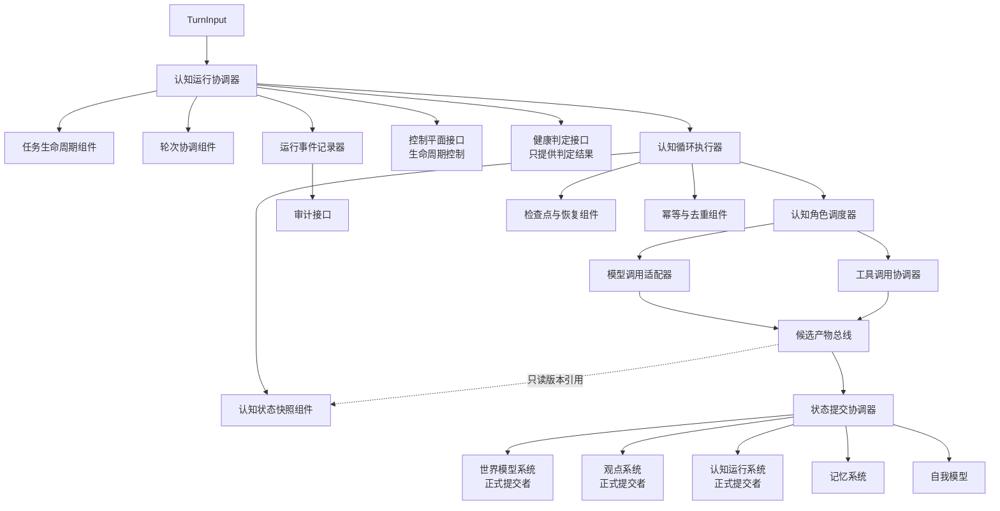
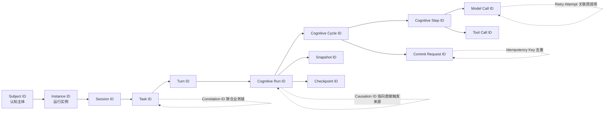
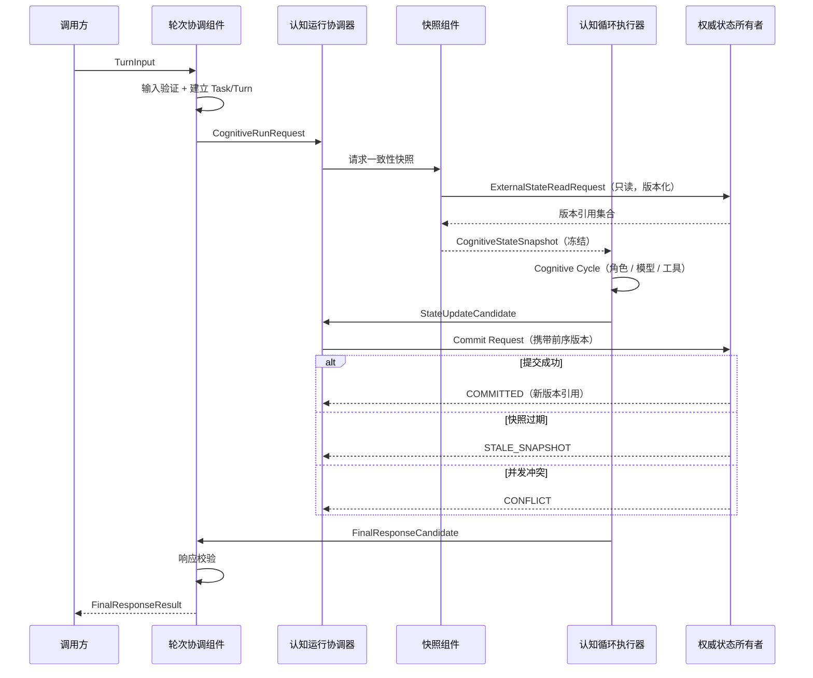
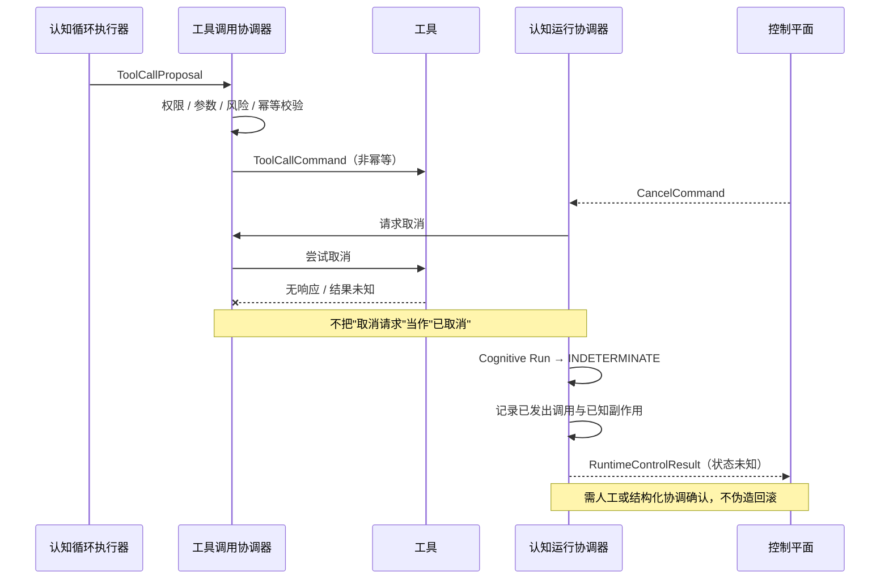
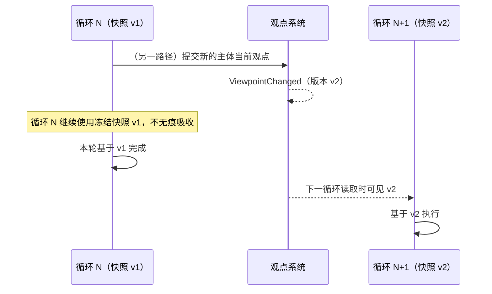

# AI-PSI 认知运行蓝皮书

**关于认知任务、轮次、认知循环、运行控制与状态提交边界的专项架构设计**

---

## 文档属性

| 属性 | 内容 |
|------|------|
| 文档版本 | Cognitive Runtime Blueprint v1.0 Candidate |
| 文档状态 | 认知运行专项架构候选基线 |
| 所属项目 | AI-PSI |
| 上位白皮书 | Whitepaper v1.0 |
| 白皮书基线提交 | 21d72cb31eb920681b1c06e13a99384179c89629 |
| 白皮书基线标签 | ai-psi-whitepaper-v1.0 |
| 上位总体架构 | Architecture Blueprint v1.0 Candidate |
| 总体架构基线提交 | b7cbb448bf06ffa86c4577823f65d74f9eee4725 |
| 上位专项蓝皮书 | World Model & Viewpoint Blueprint v1.0 Candidate |
| P2 蓝皮书提交 | 6ba1856f56040c43afa0124ebde76e190153e99f |
| P2 复验后提交 | 446133058058759f109287da82cfd6c38aaca54e |
| 文档日期 | 2026-09-23 |
| 批准状态 | 待审查 |
| 适用范围 | 认知任务、轮次、认知循环、模型调用、工具调用、状态快照与运行控制 |

> **P2 蓝皮书提交的识别依据**：`git log --diff-filter=A -- "AI-PSI-世界模型与观点蓝皮书.md"`
> 唯一命中 `6ba1856f56040c43afa0124ebde76e190153e99f`，且该提交**只含该文件一个新增项**；
> `git log --diff-filter=A -- docs/task-receipts/AI-PSI-DT-003-RECEIPT.md` 唯一命中
> `446133058058759f109287da82cfd6c38aaca54e`，同样只含一个新增项。两处均无歧义。

### 文档声明

本文件是《AI-PSI 认知运行蓝皮书》**v1.0 Candidate**，属于**认知运行专项架构候选稿**。

1. 本文描述**目标架构、运行语义与约束**，不表示相关能力已全部实现。
2. 本文受 **Whitepaper v1.0**、**总体架构 Candidate** 与 **P2 Candidate** 约束。
3. 本文**不得静默改变上位状态所有权**。
4. 本文中的 **Task、Turn、Cognitive Cycle、Model Call、Tool Call** 是**逻辑运行概念**，
   **不等于**必须建立同名物理服务或数据库表。
5. 本文**不对意识、主观体验或人格作本体论声明**。
6. **模型生成只产生候选认知产物，不自动产生权威状态。**
7. 第一阶段最小切片是**建议实现范围**，不表示代码已经存在。
8. **确定性运行控制不表示认知内容本身必须完全确定。**
9. 认知运行系统**协调**状态读取与提交，但**不夺取**世界模型、观点、记忆、自我模型或治理系统的权威所有权。

### 术语与既有实现映射

仓库已有认知运行时实现。按"**不重新定义既有语义**"的规则，列出映射。

| 本文逻辑概念 | 既有实现 | 关系 |
|---|---|---|
| Cognitive Run（认知运行） | `application/cognitive_runtime.py::CognitiveRuntime`；`RoundRequest` / `RoundOutcome` 中的 `cognitive_round_id` | 既有 `run_round()` 是**认知运行的现有实现形态**；本文不改变其语义 |
| Turn（轮次） | 一次用户消息触发的一个 `cognitive_round` | 现有实现中轮次与回合**一对一**；本文保留该边界，并把"轮次"与"认知运行"显式分层以便未来一对多 |
| Cognitive Cycle（认知循环） | `RoundState` 沿状态机的一次推进回路（如 `ANALYZING → DELIBERATING → METACOGNITIVE_REVIEW → ANALYZING`） | 既有状态机是认知循环的**现有阶段语义** |
| Cognitive Step（认知步骤） | `cognition/state_machine.py` 中的一个状态（`TRIAGING` / `FRAMING` / …） | 本文的"步骤"对应既有状态机的**状态结点** |
| Model Call | `RoundOutcome.model_calls_used` 与其预算上限（D0=3 … D4=12，ADR-0008） | 既有计数即模型调用的实现；本文把"重试"与"预算"分离 |
| 幂等身份 | `RoundRequest.idempotency_key`；API 层 `Idempotency-Key` 头 | **直接复用既有名称与语义** |
| 因果身份 | 既有 `causation_id`；`RoundOutcome.trigger_event_id` | **直接复用**：既有实现已用 `causation_id` 表达"重新激活指向原回合" |
| 事件与状态的关系 | ADR-0002：**事件日志是唯一真相来源，状态是其投影**；`cognitive_round.state_changed` | **直接复用**该结论，本文不另立第二套真相来源 |
| 状态迁移的乐观并发 | 既有 `version` 乐观锁；同一回合同一转移不可重复执行 | **直接复用** |
| 状态转移与事件同事务 | ADR-0002 已确立 | **直接复用**；本文第十一篇给出跨系统场景下的**跨系统**顺序与补偿原则 |

> **映射结论**：本文**新增**的逻辑名称仅限 Session、Task、Turn（作为显式层级）、
> Cognitive Run / Cycle / Step 的分层表述、Tool Call 系列契约、Checkpoint、
> 以及运行控制与提交结果契约；**其余一律复用既有名称**。

### 概念边界速查

| 概念 | 一句话边界 |
|------|------------|
| Session | 逻辑交互上下文，**不拥有**世界模型、观点、记忆或完整认知状态 |
| Task | 有目标、边界、生命周期与结果状态的工作单元，可跨多个 Turn |
| Turn | 一次输入接收至该次响应或明确终止的交互边界，**不等于 Model Call** |
| Cognitive Run | 一次受控认知运行实例，**必须有稳定执行身份** |
| Cognitive Cycle | 运行中的一次"读取—候选—校验—提交或继续"回路 |
| Cognitive Step | 最小可调度逻辑步骤，**不因被调度而获得权威写权限** |
| Model Call | 受控模型调用，输出是**候选内容**，可失败、超时、重试 |
| Tool Call | 经授权后的工具调用，**可能产生副作用**，须分类处理 |
| Cognitive State | 认知运行系统拥有的**运行时权威状态** |
| Snapshot | 在明确一致性边界下的**投影**，不夺取其他系统所有权 |

---

## 第一篇：目标、范围与非目标

### 1.1 本蓝皮书负责

1. 认知运行层级；
2. 任务和轮次生命周期；
3. 认知循环的协调；
4. 当前认知状态的读取和提交边界；
5. 一致性快照；
6. 认知角色调用；
7. 模型调用封装；
8. 工具调用协调；
9. 候选认知产物传递；
10. 运行命令和事件；
11. 幂等、重试、超时和取消；
12. 失败恢复与降级；
13. 运行审计与关联身份；
14. 第一阶段最小运行切片。

### 1.2 本蓝皮书不负责

| # | 不负责的内容 | 归属 |
|---|--------------|------|
| 1 | 世界模型的权威内容定义 | P2（已交付） |
| 2 | Claim、Belief、Opinion 的专项语义重定义 | P2（已交付） |
| 3 | 长期记忆晋升和遗忘策略 | P4《记忆与自我模型蓝皮书》 |
| 4 | 自我模型权威字段 | P4 |
| 5 | 元认知健康评分公式 | P5《元认知与认知稳态蓝皮书》 |
| 6 | 候选大脑的晋升资格判定 | 第三批《评测与晋升治理蓝皮书》 |
| 7 | 正式版本切换 | 第三批 |
| 8 | 数据库选型 | 后续实现阶段 |
| 9 | 模型供应商选型 | 后续实现阶段 |
| 10 | 物理微服务拓扑 | 后续实现阶段 |
| 11 | 完整权限令牌字段 | 第二批《安全、健康与恢复蓝皮书》 |
| 12 | 完整工具协议实现 | 后续实现阶段 |
| 13 | 自动结构进化 | 第三批《结构进化蓝皮书》 |
| 14 | 未经授权的外部行动 | **任何阶段均不开放** |
| 15 | 意识或人格的本体论证明 | **不属于本项目工程目标** |

### 1.3 非目标

本文**不试图**：

- 把 Turn 设计成 Model Call 的同义词；
- 用"最终一致"掩盖安全或权限错误；
- 把跨系统读取伪装成全局强事务；
- 用最后写入者获胜解决认知状态冲突；
- 要求保存或公开模型的完整隐藏思维链；
- 定义最终超时值、预算数值或重试次数。

---

## 第二篇：术语与运行层级

### 2.1 运行层级

```
Session
  └── Task
        └── Turn
              └── Cognitive Run
                    └── Cognitive Cycle
                          └── Cognitive Step
                                ├── Model Call
                                ├── Tool Call
                                ├── State Read
                                └── Commit Request
```

### 2.2 术语定义

| # | 术语 | 定义 |
|---|------|------|
| 1 | Session | 用户或调用方与系统之间的一段**逻辑交互上下文** |
| 2 | Task | 具有明确目标、边界、生命周期和结果状态的**工作单元** |
| 3 | Turn | 一次输入接收至该次响应或明确终止结果之间的**交互边界** |
| 4 | Cognitive Run | 为某个 Task 或 Turn 执行的一次**受控认知运行实例** |
| 5 | Cognitive Cycle | 运行中的一次**状态读取—候选生成—校验—提交或继续**决策回路 |
| 6 | Cognitive Step | 认知循环中的**最小可调度逻辑步骤** |
| 7 | Model Call | 对模型能力的一次**受控调用** |
| 8 | Tool Call | 经授权后对外部或内部工具能力的一次调用 |
| 9 | Tool Result | 工具返回结果，属于**不可信输入** |
| 10 | Cognitive Role Invocation | 对某个认知角色的一次受控调用 |
| 11 | Cognitive State | 认知运行系统拥有的**运行时权威状态** |
| 12 | Cognitive State Snapshot | 在明确一致性边界下读取的当前认知状态**投影** |
| 13 | State Update Candidate | 尚未提交的状态更新候选 |
| 14 | Commit Request | 向权威状态所有者请求提交变化 |
| 15 | Commit Result | 提交的明确答复 |
| 16 | Runtime Command | 请求组件执行动作的运行命令 |
| 17 | Runtime Event | 已经发生且被记录的运行事实 |
| 18 | Side Effect | 调用对外部世界产生的、不可由取消抹去的实际影响 |
| 19 | Checkpoint | 可支撑恢复的运行状态检查点 |
| 20 | Retry Attempt | 一次重试尝试，**必须与原始逻辑调用关联** |
| 21 | Idempotency Key | 用于**重复请求去重**的身份 |
| 22 | Correlation ID | 用于**聚合一条业务链**的身份 |
| 23 | Causation ID | 指向**直接触发来源**的身份 |
| 24 | Execution ID | 一次运行/步骤/调用的执行身份 |
| 25 | Subject ID | **认知主体**身份 |
| 26 | Instance ID | **运行实例**身份 |
| 27 | Cancellation | 取消过程，**请求不等于完成** |
| 28 | Suspension | 暂停，保留可恢复状态 |
| 29 | Resume | 恢复，**必须使用新的执行尝试身份** |
| 30 | Degraded Mode | 能力受限但仍在明确边界内安全运行的模式 |

### 2.3 关键关系

**A. Session** —— 逻辑交互上下文。
Session **不自动拥有**世界模型、观点、记忆或完整认知状态。

**B. Task** —— 具有明确目标、边界、生命周期和结果状态的工作单元。
一个 Session 可以包含多个 Task；**Task 可以跨多个 Turn**。

**C. Turn** —— 一次输入接收至该次响应或明确终止结果之间的交互边界。
一个 Turn **可以触发一个或多个** Cognitive Run。**Turn 不等于 Model Call。**

**D. Cognitive Run** —— 为某个 Task 或 Turn 执行的一次受控认知运行实例。
**每个 Cognitive Run 必须有稳定执行身份。**

**E. Cognitive Cycle** —— 运行中的一次"状态读取—候选生成—校验—提交或继续决策"回路。
一个 Cognitive Cycle **可以包含多个** Cognitive Step。

**F. Cognitive Step** —— 认知循环中的最小可调度逻辑步骤。
它可以调用认知角色、模型、工具或权威状态接口，
但**不能因为被调度就获得权威写权限**。

**G. Model Call** —— 对模型能力的一次受控调用。必须明确：

- Model Call **不是** Turn；
- Model Call **不是** Cognitive Cycle；
- 模型输出是**候选内容**；
- 模型输出**不能直接成为权威状态**；
- Model Call 可以**失败、超时、重试或被替代**；
- **重试后的输出不保证逐字一致**。

**H. Tool Call** —— 经授权后对外部或内部工具能力的一次调用。
Tool Call **可能产生副作用**，因此必须区分：

- 只读调用；
- 可重试幂等写调用；
- 非幂等副作用调用；
- 高风险调用。

**I. Cognitive State Snapshot** —— 认知运行系统在明确一致性边界下读取的当前认知状态投影。
它**不复制并夺取**其他系统的权威所有权。

---

## 第三篇：设计原则与核心不变量

| # | 不变量 |
|---|--------|
| 1 | 当前认知状态只有一个逻辑所有者：**认知运行系统** |
| 2 | 其他系统只能通过契约提供候选或权威读取结果 |
| 3 | 模型输出不等于权威状态 |
| 4 | 工具结果不等于已接受事实 |
| 5 | 工具执行成功不等于认知提交成功 |
| 6 | 认知提交成功不等于外部副作用成功 |
| 7 | 候选产生与正式提交必须分离 |
| 8 | 权威状态只能由其所有者提交 |
| 9 | 认知运行系统不能代替观点系统提交当前观点 |
| 10 | 认知运行系统不能代替世界模型系统提交世界模型 |
| 11 | 认知统合系统不能直接提交主体当前观点 |
| 12 | 查询视图不能成为写入口 |
| 13 | 重试不能无条件重复外部副作用 |
| 14 | 相同幂等键不能表示不同业务意图 |
| 15 | 取消不能伪造为成功 |
| 16 | 超时不能自动证明底层操作未执行 |
| 17 | 未知执行结果必须显式表示 |
| 18 | 部分失败不能被压缩为单一成功状态 |
| 19 | 生命周期转换必须由明确命令或事件驱动 |
| 20 | 事件表示已经发生的事实，不是执行命令 |
| 21 | 命令被接收不表示命令已成功执行 |
| 22 | 运行恢复必须从有效检查点或可验证状态开始 |
| 23 | 快照一致性必须有明确边界 |
| 24 | 跨系统读取不能伪装成全局强事务 |
| 25 | 新权威状态对运行的可见时点必须明确 |
| 26 | 正式状态不得被无痕覆盖 |
| 27 | 所有关键状态变化必须可审计 |
| 28 | 运行日志不得保存秘密或完整隐藏思维链 |
| 29 | 控制平面验证并执行生命周期控制 |
| 30 | 治理平面负责判定与授权，不直接执行 |
| 31 | Watchdog 不参与认知 |
| 32 | 被暂停或隔离的实例不能自行恢复高风险能力 |
| 33 | 降级模式不得静默扩大权限 |
| 34 | 运行效率不得覆盖状态所有权或安全约束 |

### 3.1 确定性边界

```
确定性的：控制流、状态转换、提交结果、审计记录、幂等去重
非确定的：模型输出、候选内容、工具返回、外部世界的实际状态
```

🔴 **不得以"逐字节确定性"要求掩盖模型的非确定性**——应通过**结构化契约与校验**
约束非确定性产物的可用范围，而不是假装它确定。

### 3.2 上位一致性

本文不得推翻或静默修改：认知运行系统拥有当前认知状态；世界模型系统拥有世界模型状态；
观点系统拥有观点和信念谱系；观点系统提交主体当前观点；认知统合系统只产生统合候选；
Claim 不等于事实；模型输出不等于信念或观点；竞争观点可以共存；未采用观点保留历史；
治理平面负责判定和授权；控制平面负责验证和执行；Watchdog 不参与认知；
健康判定与控制执行分离；正式、影子和候选大脑职责分离；候选变化不得直接修改正式大脑；
主体连续性优先；所有正式变化可审计；长期目标不等于当前已实现能力。

---

## 第四篇：总体运行架构

### 4.1 逻辑组件

| # | 组件 | 主要职责 |
|---|------|----------|
| 1 | 认知运行协调器 | 协调运行生命周期；**协调者，不是所有业务状态的所有者** |
| 2 | 任务生命周期组件 | Task 状态与结果状态提交 |
| 3 | 轮次协调组件 | Turn 生命周期与响应边界 |
| 4 | 认知循环执行器 | Cycle/Step 推进与终止条件 |
| 5 | 认知状态快照组件 | 生成一致性投影与版本引用集合 |
| 6 | 认知角色调度器 | 角色调用的编排与权限约束 |
| 7 | 模型调用适配器 | 模型调用封装；**不能提交权威认知状态** |
| 8 | 工具调用协调器 | 授权、参数、风险与幂等校验；**不能把工具输出直接写成信念或观点** |
| 9 | 候选产物总线 | 候选认知产物的逻辑传递机制 |
| 10 | 状态提交协调器 | 提交路由与确认；**不夺取业务提交权** |
| 11 | 检查点与恢复组件 | 检查点记录与恢复前置校验 |
| 12 | 幂等与去重组件 | 幂等键与事件去重 |
| 13 | 运行事件记录器 | 追加式运行事件 |
| 14 | 审计接口 | 审计记录出口 |
| 15 | 控制平面接口 | 生命周期控制；**不生成认知内容** |
| 16 | 健康判定接口 | 仅提供健康判定结果；**不参与认知统合** |
| 17 | 世界模型系统接口 | 只读读取与候选提交（不代提交） |
| 18 | 观点系统接口 | 只读读取与候选提交（不代提交） |
| 19 | 记忆系统接口 | 记忆读写候选 |
| 20 | 自我模型接口 | 自我模型版本引用 |
| 21 | 元认知系统接口 | 偏见信号与运行策略建议 |

### 4.2 架构约束

- 逻辑组件**不等于**独立服务；**不要求**为每个逻辑组件创建类；
- **认知运行协调器是协调者**，不是所有业务状态的所有者；
- **状态提交协调器负责路由和确认，不夺取业务提交权**；
- **模型适配器不能提交权威认知状态**；
- **工具调用协调器不能把工具输出直接写成信念或观点**；
- **控制平面控制生命周期，不生成认知内容**；
- **健康判定接口只提供健康判定结果，不参与认知统合**。

### 4.3 总体逻辑架构图



**图 1 · 认知运行总体逻辑架构**

图中 `候选产物总线` **没有任何**直连正式状态所有者的写入边——所有提交必须经
`状态提交协调器` 路由到**对应权威所有者**，由所有者决定提交或拒绝。
---

## 第五篇：任务、轮次与认知循环

### 5.1 层级关系

```
Session
  → Task
      → Turn
          → Cognitive Run
              → Cognitive Cycle
                  → Cognitive Step
                      → Model Call / Tool Call / State Read / Commit Request
```

### 5.2 层级规则

| # | 规则 |
|---|------|
| 1 | 一个 Task **可以跨多个** Turn |
| 2 | 一个 Turn **可以包含多个** Cognitive Run |
| 3 | 一个 Cognitive Run **可以包含多个** Cognitive Cycle |
| 4 | 一个 Cognitive Cycle **可以有多个** Model Call |
| 5 | Model Call 失败**不必导致**整个 Task 失败 |
| 6 | Tool Call 失败**不必导致**整个 Turn 失败 |
| 7 | Task 完成**不能仅由模型自由文本声明** |
| 8 | 任务完成**必须由生命周期组件按结构化结果提交** |
| 9 | **轮次响应生成**和**任务最终完成**必须区分 |
| 10 | 后台 Task **不得伪装成**已完成 Turn |
| 11 | 长任务必须支持暂停、检查点或明确不可恢复状态 |
| 12 | 循环必须有预算、终止条件和异常出口 |
| 13 | **不能只用最大模型调用次数作为唯一终止条件** |
| 14 | 认知循环结束**不表示**世界模型或观点一定发生变化 |
| 15 | **`NO_CHANGE` 是合法结果** |

### 5.3 生命周期状态集合

#### A. Task

```
CREATED · READY · RUNNING · WAITING · SUSPENDED · COMPLETED · FAILED · CANCELLED
```

#### B. Turn

```
RECEIVED · VALIDATED · RUNNING · RESPONSE_READY · COMPLETED · FAILED · CANCELLED
```

#### C. Cognitive Run

```
CREATED · SNAPSHOT_READY · RUNNING · WAITING_FOR_TOOL · WAITING_FOR_COMMIT
· SUCCEEDED · FAILED · CANCELLED · INDETERMINATE
```

#### D. Cognitive Cycle

```
PLANNED · RUNNING · CANDIDATE_READY · VALIDATING · COMMITTING
· CONTINUE · COMPLETE · FAILED · CANCELLED
```

> **状态集合不得开放无限扩展。**新增状态必须回到本蓝皮书修订，而不是在实现中就地添加。

#### E. 与既有状态机的关系（专项细化）

仓库既有 `RoundState`（14 态）是**认知循环阶段的现有实现**：

`CREATED · TRIAGING · FRAMING · RETRIEVING · ANALYZING · DELIBERATING ·
METACOGNITIVE_REVIEW · SYNTHESIZING · RESPONDING · COMPLETED ·
WAITING_FOR_EVIDENCE · SUSPENDED · FAILED · CANCELLED`

二者关系为：既有状态机定义的是**Cognitive Cycle 内部的阶段推进**；
本文 D 组定义的是**循环的协调状态**。二者**不冲突**，映射如下：

| 本文 Cycle 状态 | 既有 RoundState 对应 |
|-----------------|----------------------|
| `PLANNED` | `CREATED` / `TRIAGING` / `FRAMING` |
| `RUNNING` | `RETRIEVING` / `ANALYZING` / `DELIBERATING` / `METACOGNITIVE_REVIEW` |
| `CANDIDATE_READY` | `SYNTHESIZING` 之前形成的候选阶段 |
| `VALIDATING` / `COMMITTING` | 本文引入的**提交协调阶段**（既有实现由提交事务承担） |
| `CONTINUE` | `METACOGNITIVE_REVIEW` 的"继续"出口 |
| `COMPLETE` | `COMPLETED` |
| `FAILED` / `CANCELLED` | 同名状态 |

**本文不修改既有状态机**；该映射登记为**专项细化**，供 P9 对齐时使用。

### 5.4 状态迁移表

| 对象 | 当前状态 | 允许下一状态 | 触发者 | 提交者 | 必要条件 | 禁止条件 | 产生事件 |
|------|----------|--------------|--------|--------|----------|----------|----------|
| Task | `CREATED` | `READY` / `CANCELLED` | 任务生命周期组件 | 任务生命周期组件 | 目标与边界明确 | 无目标的任务 | `task.created` |
| Task | `READY` | `RUNNING` / `CANCELLED` | 调度 | 任务生命周期组件 | 资源与权限可用 | 权限不足 | `task.ready` |
| Task | `RUNNING` | `WAITING` / `SUSPENDED` / `COMPLETED` / `FAILED` / `CANCELLED` | 运行协调器 | 任务生命周期组件 | 结构化结果或明确原因 | 由模型文本声明完成 | `task.state_changed` |
| Task | `WAITING` | `RUNNING` / `SUSPENDED` / `CANCELLED` | 外部事件或用户 | 任务生命周期组件 | 等待条件满足 | 无依据唤醒 | `task.resumed` |
| Task | `SUSPENDED` | `RUNNING` / `CANCELLED` | 控制平面 | 任务生命周期组件 | 恢复前置校验通过 | 使用已撤销权限 | `task.resumed` |
| Turn | `RECEIVED` | `VALIDATED` / `FAILED` / `CANCELLED` | 轮次协调组件 | 轮次协调组件 | 输入结构合法 | 未校验直接执行 | `turn.received` |
| Turn | `VALIDATED` | `RUNNING` / `CANCELLED` | 轮次协调组件 | 轮次协调组件 | 身份与权限上下文就绪 | — | `turn.validated` |
| Turn | `RUNNING` | `RESPONSE_READY` / `FAILED` / `CANCELLED` | 运行协调器 | 轮次协调组件 | 至少一个运行给出候选 | 无候选即宣告完成 | `turn.state_changed` |
| Turn | `RESPONSE_READY` | `COMPLETED` / `FAILED` | 轮次协调组件 | 轮次协调组件 | 响应校验通过 | 响应校验失败仍标记完成 | `turn.completed` |
| Run | `CREATED` | `SNAPSHOT_READY` / `FAILED` / `CANCELLED` | 运行协调器 | 认知运行系统 | 运行身份已分配 | 无身份运行 | `cognitive_run.created` |
| Run | `SNAPSHOT_READY` | `RUNNING` / `INDETERMINATE` / `FAILED` / `CANCELLED` | 认知循环执行器 | 认知运行系统 | 快照一致性可判定 | 无法判定一致性仍继续 | `cognitive_run.snapshot_ready` |
| Run | `RUNNING` | `WAITING_FOR_TOOL` / `WAITING_FOR_COMMIT` / `SUCCEEDED` / `FAILED` / `INDETERMINATE` / `CANCELLED` | 认知循环执行器 | 认知运行系统 | 循环给出明确出口 | 无出口的空转 | `cognitive_run.state_changed` |
| Run | `WAITING_FOR_TOOL` | `RUNNING` / `INDETERMINATE` / `CANCELLED` | 工具调用协调器 | 认知运行系统 | 工具结果已确认 | 结果未知仍按成功继续 | `tool_call.result_received` |
| Run | `WAITING_FOR_COMMIT` | `RUNNING` / `SUCCEEDED` / `FAILED` / `INDETERMINATE` | 状态提交协调器 | 认知运行系统 | 提交结果明确 | `INDETERMINATE` 被压成失败或成功 | `commit_result.received` |
| Run | `INDETERMINATE` | `RUNNING` / `FAILED` / `CANCELLED` | 协调或人工确认 | 认知运行系统 | 外部结果被确认 | 未确认即自行收敛 | `cognitive_run.indeterminate_resolved` |
| Cycle | `PLANNED` | `RUNNING` / `CANCELLED` | 认知循环执行器 | 认知运行系统 | 步骤计划与预算就绪 | 无预算运行 | `cycle.planned` |
| Cycle | `RUNNING` | `CANDIDATE_READY` / `FAILED` / `CANCELLED` | 认知循环执行器 | 认知运行系统 | 候选已形成或明确无候选 | — | `cycle.running` |
| Cycle | `CANDIDATE_READY` | `VALIDATING` / `COMPLETE` / `CANCELLED` | 认知循环执行器 | 认知运行系统 | 候选可校验 | — | `cycle.candidate_ready` |
| Cycle | `VALIDATING` | `COMMITTING` / `CONTINUE` / `FAILED` | 状态提交协调器 | 认知运行系统 | 校验结论明确 | 跳过校验直接提交 | `cycle.validated` |
| Cycle | `COMMITTING` | `CONTINUE` / `COMPLETE` / `FAILED` / `INDETERMINATE` | 状态提交协调器 | 权威状态所有者 | 提交结果明确 | 以最后写入者获胜消解冲突 | `commit_result.received` |
| Cycle | `CONTINUE` | `PLANNED` / `RUNNING` | 认知循环执行器 | 认知运行系统 | 预算未耗尽且未达终止条件 | 超过预算仍继续 | `cycle.continued` |

> **终态不可逆**：`COMPLETED` / `FAILED` / `CANCELLED`（Task、Turn 层）；
> `SUCCEEDED` / `FAILED` / `CANCELLED`（Run 层）均为终态。
> 重新激活**必须创建新的运行实例**，并以 `Causation ID` 指向原实例——
> 这与既有实现"重新激活需创建新回合并以 `causation_id` 指向原回合"的约定一致。

---

## 第六篇：当前认知状态与一致性快照

### 6.1 当前认知状态的定义

**当前认知状态是认知运行系统拥有并正式提交的运行时权威状态。**

它**至少可以逻辑引用**：

| # | 逻辑引用 |
|---|----------|
| 1 | 当前任务 |
| 2 | 当前轮次 |
| 3 | 当前运行 |
| 4 | 当前循环 |
| 5 | 当前目标 |
| 6 | 当前计划或候选计划 |
| 7 | 当前主体观点引用 |
| 8 | 当前世界模型版本引用 |
| 9 | 当前工作记忆引用 |
| 10 | 当前自我模型版本引用 |
| 11 | 当前工具调用状态 |
| 12 | 当前预算 |
| 13 | 当前权限上下文 |
| 14 | 当前中断和健康状态 |
| 15 | 当前检查点 |
| 16 | 因果与关联身份 |

> 上述为**逻辑内容，不是数据库 Schema**。

### 6.2 快照语义

| # | 规则 |
|---|------|
| 1 | 当前认知状态保存对其他权威状态的**版本化引用** |
| 2 | **不复制**其他系统全部权威内容 |
| 3 | 快照记录**读取时可见的版本** |
| 4 | 同一认知循环**原则上使用冻结快照** |
| 5 | 循环过程中发生的新观点提交，**默认从下一循环可见** |
| 6 | 对**安全、权限、取消、隔离和高优先级控制命令**，**不得等待下一循环** |
| 7 | **紧急控制状态可中断当前循环** |
| 8 | 新证据或新观点是否立即重启循环，由**结构化策略**决定 |
| 9 | **不允许模型自行决定忽略取消或隔离** |
| 10 | 快照**不应被描述为**跨所有系统的数据库级全局事务 |
| 11 | 快照可以采用**版本向量、版本引用集合或等价逻辑语义** |
| 12 | 若无法获得所需一致性，运行必须**显式降级、重读或终止** |
| 13 | **过期快照不得静默用于高风险操作** |

### 6.3 状态可见性规则表

| 状态变化 | 对当前循环的默认可见性 | 是否可中断当前循环 | 过期处理 |
|----------|------------------------|--------------------|----------|
| 世界模型变更 | 下一循环可见 | 否 | 重读或按版本引用继续 |
| 信念变更 | 下一循环可见 | 否 | 重读或按版本引用继续 |
| 主体当前观点变更 | **下一循环可见** | 否 | 重读；不得静默吸收 |
| 工作记忆变更 | 下一循环可见（同循环内变更须显式声明） | 否 | 重读 |
| 长期记忆变更 | 下一循环可见 | 否 | 重读或按版本引用继续 |
| 自我模型变更 | 下一循环可见 | 否 | 重读 |
| **权限撤销** | **立即** | **是** | 立即终止或降级 |
| **任务取消** | **立即** | **是** | 立即进入取消路径 |
| **健康隔离** | **立即** | **是** | 立即隔离，不得自行恢复 |
| 工具结果到达 | 当前循环可见（作为不可信输入） | 否 | 检查适用范围；过期结果仍可作带时间范围的来源 |

🔴 **规则 5/6/7 的组合是本篇的核心结论**：
**认知内容的变化**默认下一循环可见，**控制与安全状态的变化**立即生效。
不得把二者混为一谈，**也不得用"等待下一循环"来拖延取消或隔离**。

### 6.4 问题解答（回应总体架构与 P2 的移交）

| 移交问题 | 本文结论 |
|---|---|
| 当前认知状态如何引用主体当前观点 | 通过**版本化引用**（当前观点修订的身份与版本），不复制内容 |
| 观点变化在认知循环中的可见时点 | **默认下一循环可见**；紧急控制类变化立即生效 |
| 运行如何读取世界模型、观点、记忆和自我模型 | 通过**只读版本化引用**形成快照，不伪装为全局强事务 |
| 跨系统状态如何形成可解释的一致性快照 | 用**版本引用集合**表达；无法获得一致性时显式降级/重读/终止 |
| 状态变化是否影响正在执行的认知循环 | **认知内容类不影响当前循环**；**控制与安全类立即影响** |

---

## 第七篇：角色、模型与认知产物

### 7.1 角色与模型

| # | 规则 |
|---|------|
| 1 | 认知角色是**逻辑职责**，不等于独立 Agent 进程 |
| 2 | 一个模型**可以承担多个**受约束角色 |
| 3 | 一个角色**可以使用不同模型**实现 |
| 4 | 模型调用输出**必须经过契约解析和校验** |
| 5 | **自由文本不能直接成为状态提交命令** |
| 6 | 角色只能提出**其权限范围内**的候选 |
| 7 | 角色**不得自授权限** |
| 8 | 角色**不得绕过**状态所有者 |
| 9 | 认知统合角色**只形成** `IntegrationCandidate` |
| 10 | **观点系统**正式提交主体当前观点 |
| 11 | **世界模型系统**正式提交世界模型修订 |
| 12 | **认知运行系统**正式提交当前认知状态 |
| 13 | 工具结果必须保留**来源和调用身份** |
| 14 | 模型失败必须产生**结构化调用结果** |
| 15 | 模型切换**不得改变契约语义** |
| 16 | 模型重试**可能产生不同候选** |
| 17 | **不得以逐字节确定性要求掩盖模型非确定性** |
| 18 | 控制流、状态转换和审计结果**应尽可能确定** |
| 19 | **隐藏思维链不属于必须持久化的认知产物** |
| 20 | 应保存**结构化依据、引用和决策摘要**，而不是完整隐藏推理 |

### 7.2 认知产物分类

| 产物 | 性质 | 可否直接成为权威状态 |
|------|------|----------------------|
| `ModelOutput` | 模型原始输出 | **否** |
| `RoleOutput` | 经角色封装的结构化输出 | **否** |
| `StateUpdateCandidate` | 状态更新候选 | **否** |
| `ToolCallProposal` | 工具调用提案 | **否**（不是执行授权） |
| `ToolResult` | 工具返回 | **否**（不可信输入） |
| `IntegrationCandidate` | 统合候选（P2 定义） | **否** |
| `CommitRequest` | 提交请求 | **否**（是请求） |
| `CommitResult` | 提交结果 | 是结果记录，非状态本身 |
| `RuntimeEvent` | 运行事实 | 是事实记录，非命令 |
| `ResponseCandidate` | 响应候选 | **否** |
| `FinalResponse` | 最终响应 | 由轮次组件提交 |

---

## 第八篇：工具调用与外部副作用

### 8.1 工具调用流程

```
ToolCallProposal
→ 权限和能力检查
→ 参数校验
→ 风险分类
→ 幂等策略检查
→ ToolCallCommand
→ 工具适配器执行
→ ToolCallResult
→ 结果验证
→ 候选认知更新
→ 权威系统提交或 NO_CHANGE
```

### 8.2 工具类型

| # | 类型 | 特征 |
|---|------|------|
| 1 | 只读工具 | 无副作用，可安全重试 |
| 2 | 无外部副作用的计算工具 | 结果取决于输入 |
| 3 | 幂等写工具 | 重复执行结果一致 |
| 4 | 非幂等副作用工具 | 重复执行可能产生额外影响 |
| 5 | 高风险工具 | 需外部授权 |
| 6 | 长时间运行工具 | 需超时与检查点 |
| 7 | 结果状态不确定的工具 | 超时后无法判定是否执行 |

### 8.3 工具调用原则

- `ToolCallProposal` **不是执行授权**；
- **模型不能直接发出已授权工具命令**；
- **控制或权限组件验证工具调用**；
- 参数**必须结构化**；
- **自由文本不得作为高风险授权**；
- **工具成功不表示结果已被主体接受**；
- 工具结果**先成为来源陈述或候选输入**；
- **超时不表示工具一定未执行**；
- **非幂等操作不得盲目自动重试**；
- **高风险副作用必须有外部授权**；
- **取消认知运行不一定能撤销已经发生的外部副作用**；
- **补偿操作必须被视为新操作，而非删除历史**；
- **工具返回内容属于不可信输入**；
- **工具结果不得注入控制命令**；
- 工具结果必须绑定**调用身份和适用范围**。

### 8.4 工具调用风险矩阵

| 类型 | 默认重试 | 幂等要求 | 授权要求 | 超时后状态 | 补偿原则 |
|------|----------|----------|----------|------------|----------|
| 只读工具 | **允许** | 不要求 | 常规 | `INDETERMINATE` 可重读 | 无需补偿 |
| 计算工具 | **允许** | 天然幂等 | 常规 | 可重算 | 无需补偿 |
| 幂等写工具 | **允许**（携带同一幂等键） | **必须** | 常规 | 可安全重试确认 | 以幂等键去重 |
| 非幂等副作用工具 | **禁止自动重试** | 不可能 | 常规+ | **`INDETERMINATE`** | **补偿是新操作**，不删历史 |
| 高风险工具 | **禁止自动重试** | 按类型 | **外部授权** | **`INDETERMINATE`** | 需人工或结构化协调 |
| 长时间运行工具 | 受检查点约束 | 按类型 | 按类型 | 检查点恢复 | 按类型 |
| 结果不确定的工具 | **禁止盲目重试** | 不可能 | 按类型 | **`INDETERMINATE`** | 确认后再决定 |

---

## 第九篇：命令、事件与状态提交

### 9.1 五类语义

| 类别 | 含义 | 关键性质 |
|------|------|----------|
| **Command** | 请求某个组件执行动作 | 可能被接受、拒绝、延迟、去重、失败、超时，或**状态未知** |
| **Event** | 已经发生且被记录的事实 | **不得被当作执行命令** |
| **Candidate** | 尚未形成权威状态的候选认知产物 | 无任何效力 |
| **Commit Request** | 向权威状态所有者请求提交变化 | **是请求，不是执行结果** |
| **Commit Result** | 提交被接受、拒绝、无变化、冲突或状态未知 | 必须**明确** |

### 9.2 提交结果闭合集合

```
COMMITTED · REJECTED · NO_CHANGE · CONFLICT
· STALE_SNAPSHOT · NOT_AUTHORIZED · INVALID · INDETERMINATE
```

| 结果 | 含义 | 必须携带 |
|------|------|----------|
| `COMMITTED` | 提交成功 | **必须携带新版本引用** |
| `REJECTED` | 被业务规则拒绝 | **必须有结构化原因** |
| `NO_CHANGE` | 无变化 | **不等于失败** |
| `CONFLICT` | 与并发提交冲突 | **不得被静默覆盖** |
| `STALE_SNAPSHOT` | 快照已过期 | **必须触发重读、重算或终止** |
| `NOT_AUTHORIZED` | 权限不足 | 权限判定依据 |
| `INVALID` | 提交内容非法 | 校验失败细节（结构化） |
| `INDETERMINATE` | 无法判定结果 | **不得伪装为失败或成功** |

### 9.3 提交原则

| # | 原则 |
|---|------|
| 1 | `COMMITTED` 必须携带新版本引用 |
| 2 | `REJECTED` 必须有结构化原因 |
| 3 | `NO_CHANGE` 不等于失败 |
| 4 | `CONFLICT` 不得被静默覆盖 |
| 5 | `STALE_SNAPSHOT` 必须触发重读、重算或终止 |
| 6 | `INDETERMINATE` 不得伪装为失败或成功 |
| 7 | 认知运行系统负责**协调**，但**业务所有者提交业务状态** |
| 8 | **多个权威系统的提交不得伪装为单一原子事务** |
| 9 | 需要多个提交时必须定义**顺序、补偿和可恢复状态** |
| 10 | **不得使用最后写入者获胜解决认知状态冲突** |

---

## 第十篇：运行身份、因果关系与幂等

### 10.1 身份目录

| # | 身份 | 用途 |
|---|------|------|
| 1 | Subject ID | 认知主体身份 |
| 2 | Instance ID | 运行实例身份 |
| 3 | Session ID | 交互上下文 |
| 4 | Task ID | 工作单元 |
| 5 | Turn ID | 交互边界 |
| 6 | Cognitive Run ID | 运行实例 |
| 7 | Cognitive Cycle ID | 循环 |
| 8 | Cognitive Step ID | 步骤 |
| 9 | Model Call ID | 模型调用 |
| 10 | Tool Call ID | 工具调用 |
| 11 | Command ID | 命令 |
| 12 | Event ID | 事件 |
| 13 | Correlation ID | 聚合一条业务链 |
| 14 | Causation ID | 指向直接触发来源 |
| 15 | Idempotency Key | 重复请求去重 |
| 16 | Snapshot ID | 快照 |
| 17 | Checkpoint ID | 检查点 |
| 18 | Commit Request ID | 提交请求 |

### 10.2 身份原则

- `Subject ID` 表示**认知主体身份**；`Instance ID` 表示**运行实例**；**二者不得混用**；
- `Correlation ID` 用于**聚合一条业务链**；
- `Causation ID` **指向直接触发来源**；
- `Idempotency Key` 用于**重复请求去重**；
- **`Idempotency Key` 不能代替业务对象身份**；
- `Retry Attempt` **必须与原始逻辑调用关联**；
- **新业务意图必须使用新幂等身份**；
- **同一工具调用的重试不得伪装成独立证据来源**；
- 事件身份必须**稳定且可去重**；
- **身份值格式不在本任务中最终决定**。

### 10.3 身份与因果关系图



**图 2 · 身份层级与因果关系**

`Retry Attempt` **不产生新的逻辑调用身份**——它以 `Causation ID` 关联原调用，
因此**同一工具的重试不会成为第二份独立证据**。

---

## 第十一篇：并发、重试与一致性

### 11.1 必须处理的并发情形

同一 Task 的并发 Turn；同一主题的并发观点候选；同一快照上的并发提交；
模型调用重试；工具调用重试；状态提交重试；重复事件；乱序事件；延迟结果；
过期快照；并发取消；部分提交。

### 11.2 并发与重试原则

| 原则 | 内容 |
|------|------|
| 并发控制 | **乐观并发或等价版本校验** |
| 提交前置 | **提交必须携带预期前序版本** |
| 冲突处理 | **版本冲突不得静默覆盖** |
| 重试前置 | **重试前必须判断操作类型** |
| 模型重试 | **产生新的 Attempt ID** |
| 工具重试 | **必须服从副作用分类**（见 8.4 矩阵） |
| 提交重试 | **使用稳定 `Commit Request ID`** |
| 重复事件 | **应去重** |
| 乱序事件 | **应按版本和因果关系校验** |
| 延迟结果 | **必须检查适用范围** |
| 过期模型输出 | **不能直接用于新状态** |
| 过期工具结果 | **仍可作为带时间范围的来源输入** |
| 部分提交 | **必须形成显式恢复状态** |
| 事务边界 | **不要求跨所有子系统使用分布式强事务** |
| 🔴 禁止 | **不允许用"最终一致"掩盖安全或权限错误** |

### 11.3 并发冲突处理表

| 冲突情形 | 检测方式 | 处理 | 禁止做法 |
|----------|----------|------|----------|
| 同一快照并发提交 | 前序版本校验 | 后到者返回 `CONFLICT` | 最后写入者获胜 |
| 快照已过期 | 版本引用比对 | 返回 `STALE_SNAPSHOT`；重读后重算 | 静默按旧快照提交 |
| 重复提交请求 | `Idempotency Key` / `Commit Request ID` | 去重，返回首次结果 | 重复产生副作用 |
| 重复事件 | `Event ID` | 去重 | 重复触发下游 |
| 乱序事件 | 版本 + `Causation ID` | 拒绝倒退状态，记录异常 | 接受旧事件覆盖新状态 |
| 模型重试 | `Retry Attempt` | 新候选重新走校验 | 把重试当独立证据 |
| 工具重试（非幂等） | 副作用分类 | 禁止自动重试，进入 `INDETERMINATE` | 盲目重试 |
| 并发取消 | 取消命令优先级 | 立即生效 | 排队等待 |
| 部分提交 | 多系统提交顺序记录 | 形成显式恢复状态 | 压缩为整体成功 |
| 延迟结果到达 | 适用范围与时间 | 作为带范围的来源输入 | 直接写入当前状态 |
---

## 第十二篇：中断、取消、暂停与恢复

### 12.1 中断类型

| # | 类型 | 优先级 |
|---|------|--------|
| 1 | 用户取消 | 高 |
| 2 | 系统取消 | 高 |
| 3 | 超时终止 | 中 |
| 4 | **健康隔离** | **最高** |
| 5 | **权限撤销** | **最高** |
| 6 | 预算耗尽 | 中 |
| 7 | 人工暂停 | 高 |
| 8 | 可恢复故障 | 中 |
| 9 | 不可恢复故障 | 高 |
| 10 | 状态未知 | 需协调 |

### 12.2 中断与恢复原则

- **Cancel Request 不等于已取消**；
- **已发出的模型调用可能无法立即停止**；
- **已发生的工具副作用不能通过取消抹去**；
- **权限撤销和健康隔离具有高优先级**，**立即生效**；
- **被隔离实例不得自行恢复**；
- **恢复前必须验证检查点、权限、健康和状态版本**；
- **恢复后必须使用新的执行尝试身份**；
- 原 `Cognitive Run` 身份和新 `Attempt` 身份**均应保留**；
- **不安全检查点不得恢复**；
- 无法确认外部副作用结果时**必须进入 `INDETERMINATE`**；
- `INDETERMINATE` **需要人工或结构化协调流程**；
- **恢复不能删除原失败历史**；
- **暂停期间到达的新观点或世界模型版本必须在恢复时重新校验**；
- **恢复不得继续使用已撤销能力令牌**。

### 12.3 检查点逻辑记录

| # | 逻辑记录项 |
|---|------------|
| 1 | 运行身份 |
| 2 | 当前生命周期状态 |
| 3 | 快照引用 |
| 4 | 已完成步骤 |
| 5 | 未完成步骤 |
| 6 | 已发出工具调用 |
| 7 | 已知副作用 |
| 8 | 待确认结果 |
| 9 | 预算状态 |
| 10 | 权限上下文摘要 |
| 11 | 恢复条件 |
| 12 | 审计引用 |

> **不定义具体存储 Schema。**

---

## 第十三篇：核心契约

本文只定义**逻辑契约**，**不定义** Pydantic / SQL / JSON Schema / Protobuf /
API 路由 / 消息中间件主题 / 数据库表。

### 13.1 契约目录

| # | 契约 | 类型 | 产生者 | 消费者 | 副作用 | 身份要求 | 幂等要求 | 禁止代表的语义 |
|---|------|------|--------|--------|--------|----------|----------|----------------|
| 1 | `TaskRequest` | 请求 | 调用方 | 任务生命周期组件 | 否 | Task ID | 建议 | 不表示任务已被接受 |
| 2 | `TaskCommand` | 命令 | 控制平面 / 调用方 | 任务生命周期组件 | 否 | Command ID | **必须** | 不表示命令已执行 |
| 3 | `TaskState` | 状态 | 任务生命周期组件 | 运行协调器、审计 | 否 | Task ID + 版本 | — | 不是事件日志 |
| 4 | `TaskResult` | 结果 | 任务生命周期组件 | 调用方、审计 | 否 | Task ID | — | 不由模型自由文本产生 |
| 5 | `TurnInput` | 请求 | 调用方 | 轮次协调组件 | 否 | Turn 前身 | 建议 | 不表示输入已被接受为事实 |
| 6 | `TurnState` | 状态 | 轮次协调组件 | 运行协调器、审计 | 否 | Turn ID + 版本 | — | 不是事件日志 |
| 7 | `CognitiveRunRequest` | 请求 | 运行协调器 | 认知运行系统 | 否 | Cognitive Run ID | **必须** | 不表示运行已开始 |
| 8 | `CognitiveRunState` | 状态 | 认知运行系统 | 审计、控制平面 | 否 | Run ID + 版本 | — | 不是事件日志 |
| 9 | `CognitiveStateSnapshot` | 状态 | 快照组件 | 循环执行器 | 否 | Snapshot ID + 版本集合 | 只读 | **不是全局强事务保证** |
| 10 | `CognitiveStepPlan` | 计划 | 循环执行器 | 认知循环执行器 | 否 | Step ID | — | 不表示步骤已执行 |
| 11 | `RoleInvocationRequest` | 请求 | 循环执行器 | 角色调度器 | 否 | 调用 ID | 建议 | 不授予权限 |
| 12 | `RoleInvocationResult` | 结果 | 角色调度器 | 循环执行器 | 否 | 关联调用 ID | — | **不是权威状态** |
| 13 | `ModelCallRequest` | 请求 | 模型适配器 | 模型运行环境 | 否 | Model Call ID | 建议 | 不表示输出可用 |
| 14 | `ModelCallResult` | 结果 | 模型适配器 | 循环执行器 | 否 | 关联调用 ID | — | **模型输出是候选内容** |
| 15 | `ToolCallProposal` | 候选 | 认知角色 | 工具调用协调器 | 否 | Tool Call 前身 | — | **不是执行授权** |
| 16 | `ToolCallCommand` | 命令 | 工具调用协调器 | 工具适配器 | **是** | Tool Call ID + Command ID | **按副作用分类** | 不表示已执行 |
| 17 | `ToolCallResult` | 结果 | 工具适配器 | 协调器、循环执行器 | 否 | 关联 Tool Call ID | 按分类 | **不是已接受事实** |
| 18 | `StateUpdateCandidate` | 候选 | 角色 / 循环执行器 | 状态提交协调器 | 否 | 候选 ID | — | 不表示已提交 |
| 19 | `CognitiveStateCommitRequest` | 请求 | 状态提交协调器 | **认知运行系统** | 否 | Commit Request ID + 前序版本 | **必须** | **是请求，不是结果** |
| 20 | `CognitiveStateCommitResult` | 结果 | 认知运行系统 | 协调器、审计 | 否 | 关联请求 ID | — | 必须**明确**接受或拒绝 |
| 21 | `ExternalStateReadRequest` | 请求 | 快照组件 | 各权威系统 | 否 | 请求 ID | 只读 | 不授予写权限 |
| 22 | `ExternalStateReadResult` | 结果 | 各权威系统 | 快照组件 | 否 | 关联请求 ID + 版本 | — | **不是快照本身** |
| 23 | `CheckpointRecord` | 状态 | 检查点组件 | 恢复组件、审计 | 否 | Checkpoint ID | — | 不表示可安全恢复 |
| 24 | `ResumeCommand` | 命令 | 控制平面 / 协调器 | 恢复组件 | 否 | Command ID | **必须** | 不表示已恢复 |
| 25 | `CancelCommand` | 命令 | 用户 / 系统 / 控制平面 | 运行协调器 | 否 | Command ID | **必须** | **不表示已取消** |
| 26 | `RuntimeControlResult` | 结果 | 运行协调器 | 控制平面、审计 | 否 | 关联 Command ID | — | 不伪装取消为成功 |
| 27 | `RuntimeEvent` | **事件** | 各组件 | 事件记录器、审计 | 否 | Event ID | **必须可去重** | **不是执行命令** |
| 28 | `BudgetState` | 状态 | 循环执行器 | 协调器、审计 | 否 | Run ID + 版本 | — | 不表示资源已被消耗完毕 |
| 29 | `PermissionContext` | 状态 | 控制平面 | 工具协调器、循环执行器 | 否 | 上下文 ID + 版本 | — | **不是权限本身**，是引用 |
| 30 | `FinalResponseCandidate` | 候选 | 循环执行器 | 轮次协调组件 | 否 | Turn ID | — | 不表示任务已完成 |
| 31 | `FinalResponseResult` | 结果 | 轮次协调组件 | 调用方、审计 | **是**（对外交付） | Turn ID | **必须** | 不表示 Task 永久完成 |

### 13.2 与 P2 契约的关系

以下契约由 **P2 定义，本文不重新定义其核心语义**：

| P2 契约 | 本文中的关系 |
|---------|--------------|
| `WorldModelUpdateProposal` | 本文产生的候选**可经此契约**提交给**世界模型系统**；本文不代提交 |
| `BeliefCandidate` | 同上，提交给**观点系统** |
| `OpinionCandidate` | 同上 |
| `IntegrationCandidate` | 由**认知统合系统**产生，本文的角色调度器只是触发者 |
| `ViewpointCommitRequest` | 由**认知统合系统**发出，**不由认知运行系统发出** |
| `ViewpointCommitResult` | 由**观点系统**返回，本文只做关联记录 |
| `WorldModelChanged` | 本文作为**外部事件**消费（下一循环可见） |
| `BeliefChanged` | 同上 |
| `ViewpointChanged` | 同上（**默认下一循环可见**） |

🔴 **本文不修改、不复制、不重定义上述任何一个 P2 契约。**

### 13.3 命令 / 事件 / 候选 / 请求 / 结果的区分

| 类别 | 本文示例 |
|------|----------|
| 命令（Command） | `TaskCommand`、`ToolCallCommand`、`ResumeCommand`、`CancelCommand` |
| 事件（Event） | `RuntimeEvent`、`WorldModelChanged`、`BeliefChanged`、`ViewpointChanged` |
| 候选（Candidate） | `StateUpdateCandidate`、`ToolCallProposal`、`FinalResponseCandidate`、`IntegrationCandidate` |
| 请求（Request） | `CognitiveStateCommitRequest`、`RoleInvocationRequest`、`ExternalStateReadRequest` |
| 结果（Result） | `CognitiveStateCommitResult`、`ToolCallResult`、`RuntimeControlResult`、`FinalResponseResult` |

---

## 第十四篇：端到端运行流程

### 14.1 A · 标准用户轮次

```
TurnInput
→ 输入验证
→ Task/Turn 生命周期建立
→ 创建 Cognitive Run
→ 获取 Cognitive State Snapshot
→ 执行 Cognitive Cycle
→ 产生候选
→ 必要的权威状态提交
→ 形成 FinalResponseCandidate
→ 响应校验
→ FinalResponseResult
→ Turn 完成
```

### 14.2 B · 世界模型与观点参与流程

```
读取版本化世界模型和当前观点
→ 形成冻结快照
→ 角色生成候选
→ 认知统合形成 Integration Candidate
→ 观点系统提交或拒绝
→ ViewpointChanged
→ 下一认知循环可见
```

🔴 **默认情况下，本循环不无痕吸收中途变化。**

### 14.3 C · 工具调用流程

```
认知角色提出 ToolCallProposal
→ 权限、参数、风险和幂等校验
→ ToolCallCommand
→ 工具执行
→ ToolCallResult
→ 结果作为不可信输入验证
→ 形成候选认知更新
→ 权威系统提交或 NO_CHANGE
```

### 14.4 D · 过期快照冲突流程

```
基于 Snapshot A 产生候选
→ 权威状态已变为 Version B
→ 提交返回 STALE_SNAPSHOT 或 CONFLICT
→ 重读
→ 重算、降级或终止
→ 不允许静默覆盖
```

### 14.5 E · 取消与副作用状态未知流程

```
ToolCall 已发出
→ 收到 CancelCommand
→ 尝试取消
→ 工具结果未知
→ Cognitive Run 进入 INDETERMINATE
→ 协调或人工确认
→ 记录最终结果
→ 不伪造回滚
```

### 14.6 F · 模型调用失败与降级流程

```
Model Call 失败
→ 分类错误
→ 判断是否允许重试
→ 新 Attempt
→ 仍失败时选择替代模型、降级路径或终止
→ 结构化记录
→ 不将错误文本作为模型输出继续使用
```

### 14.7 标准轮次时序图



**图 3 · 标准用户轮次时序（提交者始终是权威状态所有者）**

### 14.8 工具副作用未知时序图



**图 4 · 非幂等工具超时：进入显式未知而非伪造成功或失败**

### 14.9 新观点可见性时序图



**图 5 · 认知内容类变化的默认可见时点为下一循环**

---

## 第十五篇：可观测性、审计与隐私

### 15.1 可观测性要求

| # | 要求 |
|---|------|
| 1 | 任务和轮次状态可观测 |
| 2 | 认知运行和循环状态可观测 |
| 3 | 模型调用元数据可观测 |
| 4 | 工具调用状态和副作用状态可观测 |
| 5 | 提交请求和结果可关联 |
| 6 | 重试次数和原因可观测 |
| 7 | 取消、暂停和恢复可审计 |
| 8 | 快照版本引用可追踪 |
| 9 | 候选与正式提交可区分 |
| 10 | **`NO_CHANGE` 必须可观测** |
| 11 | **`INDETERMINATE` 必须产生告警或治理信号** |
| 12 | 日志**不得记录** API Key、令牌、密码或数据库凭据 |
| 13 | 工具结果中的敏感内容必须受保护 |
| 14 | 用户输入**不得无条件**完整写入所有日志 |
| 15 | **不要求保存模型完整隐藏思维链** |
| 16 | 应保存**结构化决策摘要、状态引用、错误分类和依据引用** |
| 17 | 可观测性数据**不是**业务权威状态 |
| 18 | **Trace 或日志不能被反向用作正式提交入口** |
| 19 | 审计记录采用**追加式语义** |
| 20 | 清理可观测性数据不得破坏必要治理证据 |

### 15.2 观测维度

| 维度 | 说明 |
|------|------|
| 生命周期状态 | Task / Turn / Run / Cycle 的当前状态分布 |
| 延迟 | 各层级耗时 |
| 调用次数 | Model Call / Tool Call 计数 |
| 重试次数 | 按对象与原因分类 |
| 错误分类 | 结构化错误类别 |
| 预算消耗 | 相对预算上限的消耗 |
| 快照陈旧程度 | 快照版本与当前版本的距离 |
| 冲突次数 | `CONFLICT` / `STALE_SNAPSHOT` 计数 |
| 取消延迟 | 从 CancelCommand 到实际停止 |
| 状态未知数量 | `INDETERMINATE` 数量（**须告警**） |
| 权限拒绝数量 | `NOT_AUTHORIZED` 计数 |
| 提交接受和拒绝数量 | `COMMITTED` / `REJECTED` 分布 |

> **不得规定最终监控产品。**

---

## 第十六篇：失败模式与安全边界

| # | 失败模式 | 触发条件 | 风险 | 防护约束 | 可观测信号 | 恢复或降级原则 |
|---|----------|----------|------|----------|------------|----------------|
| 1 | 把 Turn 等同于 Model Call | 概念混用 | 层级失真、预算错算 | 第二篇 2.3 C/G | 一个 Turn 只对应一次调用 | 恢复层级语义 |
| 2 | 把模型输出直接写入当前认知状态 | 跳过候选与校验 | 未授权状态变化 | 不变量 3、7、8 | 存在无候选来源的状态变化 | 回退并补校验 |
| 3 | 把工具结果直接写成事实 | 跳过来源标记 | 外部污染认知 | 不变量 4 | 工具输出无来源身份 | 降级为来源陈述 |
| 4 | 认知运行系统夺取观点系统写权限 | 越权提交 | 违反上位所有权 | 不变量 9 | 出现非观点系统提交的观点 | 拒绝并记录 |
| 5 | 认知运行系统夺取世界模型写权限 | 越权提交 | 违反上位所有权 | 不变量 10 | 出现非世界模型系统的提交 | 拒绝并记录 |
| 6 | 认知统合系统直接提交当前观点 | 绕过观点系统 | 正式状态被非法写入 | 不变量 11 | 提交者身份不符 | 拒绝并产生结构化拒绝结果 |
| 7 | 同一任务并发运行产生无痕覆盖 | 无版本校验并发写 | 状态丢失 | 乐观并发；前序版本 | 版本跳跃且无继承 | 恢复前序版本 |
| 8 | 过期快照提交成功 | 未校验版本 | 覆盖新状态 | `STALE_SNAPSHOT` | 快照版本低于当前版本 | 重读后重算 |
| 9 | 最后写入者获胜 | 以时间戳决胜 | 冲突被掩盖 | 不变量 26 | 冲突数量为零而并发量高 | 重新引入显式冲突 |
| 10 | 模型调用盲目重试 | 无错误分类重试 | 成本失控、结果漂移 | 11.2 重试前置判断 | 重试次数异常升高 | 按错误分类决定 |
| 11 | 非幂等工具盲目重试 | 未分类副作用 | **重复外部副作用** | 8.4 矩阵 | 同一业务意图多次副作用 | 停止重试，进入协调 |
| 12 | 工具超时被误判为未执行 | 忽略不确定性 | 双写或漏写 | 不变量 16 | 超时后状态被直接置为失败 | 改为 `INDETERMINATE` |
| 13 | 取消被误报为成功完成 | 取消路径与成功路径混淆 | 虚假完成 | 不变量 15 | 取消后状态为 `COMPLETED` | 改为 `CANCELLED` |
| 14 | 部分提交被误报为整体成功 | 多系统提交压缩 | 状态不一致 | 不变量 18 | 多提交只有部分成功 | 形成显式恢复状态 |
| 15 | `INDETERMINATE` 被压成 `FAILED` | 状态集合被简化 | 丢失需协调的信息 | 9.2 结果集合 | 状态未知数量恒为零 | 恢复显式未知 |
| 16 | 重复事件导致重复副作用 | 未去重 | 重复执行 | 事件身份去重 | 同一 Event ID 多次生效 | 去重并补偿 |
| 17 | 乱序事件倒退状态 | 无版本/因果校验 | 状态回退 | 11.3 乱序处理 | 状态版本倒退 | 拒绝并记录异常 |
| 18 | 恢复使用已撤销权限 | 未重新校验权限 | **权限绕过** | 12.2 恢复前校验 | 恢复时权限上下文过期 | 拒绝恢复 |
| 19 | 隔离实例自行恢复 | 自恢复路径存在 | 安全问题 | 不变量 32 | 隔离后自行回到 RUNNING | 强制外部授权 |
| 20 | 快照伪装成全局强一致事务 | 措辞与实现不符 | 错误假设 | 不变量 24 | 声称跨系统原子 | 更正为版本引用语义 |
| 21 | 查询视图成为写入口 | 写路径引用投影 | 绕过提交规则 | 不变量 12 | 写请求来自查询组件 | 强制回到权威读取 |
| 22 | 自由文本成为高风险控制命令 | 自然语言直通控制 | 权限绕过 | 不变量 19；8.3 | 控制命令含自由文本载荷 | 拒绝并要求结构化命令 |
| 23 | 工具输出注入控制指令 | 未隔离工具返回 | 提示注入 | 8.3 工具结果为不可信输入 | 工具返回含控制语义 | 视为数据，剥离控制语义 |
| 24 | 隐藏思维链被不必要持久化 | 无差别记录 | 隐私与合规风险 | 不变量 28 | 日志含完整推理文本 | 改为结构化摘要 |
| 25 | 日志泄漏秘密 | 未脱敏 | 安全事故 | 15.1 第 12 条 | 日志含凭据模式 | 脱敏并轮换凭据 |
| 26 | 预算耗尽后继续运行 | 预算检查缺失 | 资源失控 | 12.1 类型 6 | 调用数超上限仍继续 | 结构化终止 |
| 27 | 模型输出格式错误被静默接受 | 校验缺失 | 未校验内容进入下游 | 7.1 第 4 条 | 解析失败却继续 | 拒绝并结构化记录 |
| 28 | 新观点在循环中途产生不可重复行为 | 未冻结快照 | 同输入不同结果 | 6.2 第 4 条 | 同输入两次运行结果不同 | 强制使用冻结快照 |
| 29 | 失败恢复删除原始历史 | 恢复实现为覆盖 | 谱系断裂 | 12.2 保留原身份 | 修订链断裂 | 改为追加式恢复记录 |
| 30 | 降级模式扩大权限 | 降级逻辑错误 | 权限越界 | 不变量 33 | 降级后权限集合变大 | 拒绝并回滚降级 |
| 31 | 任务完成由模型自我声明 | 缺生命周期校验 | 虚假完成 | 5.2 第 7、8 条 | `TaskResult` 无结构化依据 | 改为生命周期组件提交 |
| 32 | 同一工具重试被当成多份独立证据 | 身份未关联 | 虚假证据强度 | 10.2 最后一条 | 同一 Tool Call ID 家族被多次计数 | 以 `Causation ID` 合并计数 |

---

## 第十七篇：第一阶段最小架构切片

### 17.1 切片范围

```
1  接收结构化 TurnInput
2  创建 Task 和 Turn
3  创建 Cognitive Run
4  读取一个版本化 Cognitive State Snapshot
5  调用一个或多个模拟认知角色
6  通过 Mock Model Adapter 产生候选输出
7  校验 RoleInvocationResult
8  可选地产生只读 ToolCallProposal
9  通过 Mock Tool Adapter 返回 ToolCallResult
10 形成 StateUpdateCandidate
11 提交 CognitiveStateCommitRequest
12 接收 Commit Result
13 形成 FinalResponseCandidate
14 输出 FinalResponseResult
15 写入结构化 Runtime Event
16 支持一次受控重试
17 支持取消
18 支持过期快照冲突
19 支持 NO_CHANGE
20 支持 INDETERMINATE 的显式结果
```

### 17.2 第一阶段边界（不要求的能力）

| # | 不要求 |
|---|--------|
| 1 | 真实外部 Provider |
| 2 | 真实高风险工具 |
| 3 | 最终数据库 |
| 4 | 分布式事务 |
| 5 | 复杂消息中间件 |
| 6 | 完整长期记忆 |
| 7 | 完整自我模型 |
| 8 | 自动结构进化 |
| 9 | 自动修改正式大脑 |
| 10 | 全自动治理 |
| 11 | 最终微服务部署 |
| 12 | 暴露隐藏思维链 |

### 17.3 第一阶段验收场景

以下为**场景定义**，本任务**不编写测试代码**。

| # | 场景 | 期望结果 |
|---|------|----------|
| 1 | 单轮无工具调用正常完成 | Turn → `COMPLETED`，事件完整 |
| 2 | 一个 Turn 包含两个 Model Call | 两次调用各自有身份，预算正确计数 |
| 3 | 模型输出格式非法 | 被拒绝，产生结构化错误，不进入下游 |
| 4 | 模型第一次失败、第二次受控重试成功 | 新 `Attempt`，与原调用以 `Causation ID` 关联 |
| 5 | 只读工具调用成功 | 结果以来源身份进入候选 |
| 6 | 工具结果成为候选输入而非事实 | 权威状态未因工具结果自动改变 |
| 7 | 非幂等工具超时 | 进入 **`INDETERMINATE`**，不伪造成功或失败 |
| 8 | 相同幂等请求不重复产生副作用 | 去重命中，返回首次结果 |
| 9 | 过期快照提交 | 返回 **`STALE_SNAPSHOT`**，触发重读 |
| 10 | 并发提交 | 返回 **`CONFLICT`**，不静默覆盖 |
| 11 | `NO_CHANGE` 被正确记录 | 结果为 `NO_CHANGE` 且可观测，非失败 |
| 12 | 用户取消发生在 Model Call 前 | Run → `CANCELLED`，无副作用 |
| 13 | 用户取消发生在 Tool Call 后 | 已知副作用被记录；结果未知则 `INDETERMINATE` |
| 14 | 权限撤销立即阻止新工具调用 | 新调用返回 `NOT_AUTHORIZED` |
| 15 | 健康隔离中断运行 | 运行被立即中断，不等下一循环 |
| 16 | 被隔离实例不能自行恢复 | 恢复请求被拒绝，需外部授权 |
| 17 | 新观点提交从下一认知循环可见 | 当前循环不受影响，下一循环可见 |
| 18 | 紧急取消不等待下一认知循环 | 立即生效 |
| 19 | 认知统合候选不能直接成为当前观点 | 缺少提交路径，写入失败 |
| 20 | 世界模型候选不能由认知运行系统直接提交 | 提交者身份不符，被拒绝 |
| 21 | 重试的同一工具结果不被算作独立证据 | 以 `Causation ID` 合并计数 |
| 22 | 恢复时发现快照过期并重新读取 | 恢复流程重新获取快照 |
| 23 | 预算耗尽导致结构化终止 | 运行终止并记录原因 |
| 24 | `FinalResponse` 不等于 Task 永久完成 | Turn 完成而 Task 仍可为 `RUNNING` |
| 25 | 审计记录不包含秘密或隐藏思维链 | 审计仅含结构化摘要与引用 |

---

## 第十八篇：跨专项接口与未决问题

### 18.1 交给 P4《记忆与自我模型蓝皮书》

- 工作记忆与当前认知状态的边界；
- 工作记忆在 Task、Turn 和 Cognitive Run 中的生命周期；
- 长期记忆读取的一致性和版本引用；
- 记忆写入候选何时提交；
- 认知状态快照如何引用记忆；
- 任务结束后哪些运行状态可以晋升为记忆；
- 自我模型版本变化何时对认知循环可见；
- 运行实例身份与主体身份的关系；
- 检查点是否属于记忆；
- 工具结果保留与遗忘规则。

### 18.2 交给 P5《元认知与认知稳态蓝皮书》

- 运行健康信号与认知健康信号的边界；
- 循环失控检测；
- 重复重试和重复反思检测；
- 预算异常；
- 观点频繁反转的运行信号；
- 元认知提出运行策略变化的权限；
- 元认知不能直接提交业务状态；
- 稳态对暂停、降级和恢复的影响；
- 健康判定如何中断运行；
- 认知性能指标与主体能力判断的边界。

### 18.3 交给 P6 交叉一致性审查

- Task、Turn、Run、Cycle 的共享定义；
- P2 事件和 P3 命令的对应关系；
- 当前观点可见时点；
- 快照版本模型；
- 记忆引用语义；
- 主体身份与实例身份；
- 事件、命令、候选、请求和结果的命名；
- 第一阶段切片能否组合；
- 状态所有权矩阵是否冲突；
- 是否需要对总体架构进行受控回写。

### 18.4 后续治理或实现阶段

- 最终数据库事务边界；
- 最终消息投递语义；
- 最终 API 设计；
- 最终模型适配器；
- 最终工具沙箱；
- 最终权限令牌字段；
- 最终超时值和预算数值；
- 最终部署拓扑。

### 18.5 未决问题表

| 编号 | 问题 | 当前结论 | 责任专项或阶段 | 是否阻断 P3 Candidate |
|------|------|----------|----------------|----------------------|
| V-01 | Task、Turn、Cognitive Run、Cycle、Step 的层级关系 | **已解决**：五级层级与规则见第五篇 | 本文 | 否 |
| V-02 | 当前认知状态的逻辑内容与所有权 | **已解决**：认知运行系统拥有并提交，内容见第六篇 6.1 | 本文 | 否 |
| V-03 | 观点变化在认知循环中的可见时点 | **已解决**：内容类**下一循环可见**；控制与安全类**立即生效** | 本文 | 否 |
| V-04 | 快照一致性语义 | **已解决**：版本引用集合，**不伪装为全局强事务**；无法一致时降级/重读/终止 | 本文 | 否 |
| V-05 | 命令、事件、候选、请求、结果的区分 | **已解决**：五类语义与八个提交结果，见第九篇 | 本文 | 否 |
| V-06 | 重试、幂等与副作用边界 | **已解决**：按副作用分类；非幂等禁止自动重试；`Causation ID` 关联重试 | 本文 | 否 |
| V-07 | 中断、取消、暂停与恢复语义 | **已解决**：取消请求≠完成；恢复需重新校验权限与版本；失败历史保留 | 本文 | 否 |
| V-08 | 工作记忆与当前认知状态的边界 | 未解决 | **P4** | 否 |
| V-09 | 任务结束后哪些运行状态可晋升为记忆 | 未解决 | **P4** | 否 |
| V-10 | 检查点是否属于记忆 | 未解决 | **P4** | 否 |
| V-11 | 运行实例身份与主体身份的关系 | 未解决（本文已规定二者不得混用，但关系定义移交） | **P4** | 否 |
| V-12 | 运行健康信号与认知健康信号的边界 | 未解决 | **P5** | 否 |
| V-13 | 循环失控与重复重试的检测方式 | 未解决 | **P5** | 否 |
| V-14 | 元认知提出运行策略变化的权限边界 | 未解决 | **P5** | 否 |
| V-15 | 最终数据库事务边界与消息投递语义 | 未解决（不宜过早决定） | 后续实现阶段 | 否 |
| V-16 | 最终超时值、预算数值与重试次数 | 未解决（不宜过早决定） | 后续实现阶段 | 否 |
| V-17 | 既有 `RoundState` 与本文 Cycle 状态的映射是否需要在实现层显式化 | 本文给出映射（第五篇 5.3 E），未修改实现 | **P9** | 否 |

### 18.6 上位回写候选

本文在编写过程中对**上位文档**未作任何修改。以下事项如需上位调整，登记为**上位回写候选**，留待 **P6** 处理：

| 编号 | 回写候选 | 涉及上位位置 | 现状 |
|------|----------|--------------|------|
| R-01 | 总体架构 6.2 是否需要补充"任务生命周期""轮次"等运行时状态行 | 总体架构 6.2 | 本文**未**要求修改 |
| R-02 | 总体架构 8.1 是否需要补充运行时控制契约（`CancelCommand` / `CheckpointRecord` 等） | 总体架构 8.1 | 同上 |
| R-03 | P2 蓝皮书的事件名与本文命令名的对应关系是否需要在 P6 统一登记 | P2 第十二篇 | 同上 |

---

## 第十九篇：作者自检与验收标准

本章勾选表示《AI-PSI 认知运行蓝皮书》v1.0 Candidate 已完成作者自检，**不代表文档已经获得正式批准，也不代表相关能力已经实现**。正式冻结需完成 P4、P5、P6 及后续批准流程。

### A. 上位基线一致性

- [x] 引用正确的 Whitepaper v1.0
- [x] 引用正确的总体架构提交
- [x] 引用正确的 P2 蓝皮书提交
- [x] 未修改 P0—P2 上位文档
- [x] 未改变四平面边界
- [x] 未改变状态所有权原则
- [x] 未将候选能力写成已实现能力

### B. 运行层级

- [x] Session、Task、Turn 已区分
- [x] Cognitive Run、Cycle、Step 已区分
- [x] Model Call 不等于 Turn
- [x] Tool Call 不等于认知提交
- [x] Task 完成不由模型自由文本决定
- [x] 各主要生命周期闭合

### C. 状态与快照

- [x] 当前认知状态由认知运行系统拥有
- [x] 世界模型状态仍由世界模型系统提交
- [x] 主体当前观点仍由观点系统提交
- [x] 认知统合系统只产生统合候选
- [x] 快照不被描述为全局强事务
- [x] 状态可见时点明确
- [x] 过期快照处理明确
- [x] 不存在双重正式写入者

### D. 命令、事件与提交

- [x] Command 与 Event 已区分
- [x] Candidate 与 Commit 已区分
- [x] Commit Request 与 Commit Result 已区分
- [x] NO_CHANGE 已定义
- [x] CONFLICT 已定义
- [x] STALE_SNAPSHOT 已定义
- [x] INDETERMINATE 已定义
- [x] 多系统提交未被伪装为单一原子事务

### E. 重试与副作用

- [x] 模型重试语义明确
- [x] 工具重试语义明确
- [x] 非幂等副作用不会盲目重试
- [x] 工具超时不等于未执行
- [x] 幂等身份与业务身份已区分
- [x] 重复事件不会重复产生副作用
- [x] 同一工具重试不会成为独立证据

### F. 中断与恢复

- [x] 取消请求与取消完成已区分
- [x] 权限撤销可立即生效
- [x] 健康隔离可中断运行
- [x] 被隔离实例不能自行恢复
- [x] 检查点恢复条件明确
- [x] 恢复不会删除失败历史
- [x] 已撤销权限不会在恢复后继续使用

### G. 安全与审计

- [x] 高风险工具需要外部授权
- [x] 工具结果被视为不可信输入
- [x] 自由文本不能成为高风险命令
- [x] 日志不得包含秘密
- [x] 不要求保存隐藏思维链
- [x] 关键状态变化可审计
- [x] 降级模式不会扩大权限

### H. 跨专项与治理

- [x] P4 移交项完整
- [x] P5 移交项完整
- [x] P6 审查项完整
- [x] 上位回写候选已登记
- [x] 第一阶段切片保持克制
- [x] 文档仍为 Candidate
- [x] 未创建字段级 Schema
- [x] 未修改程序代码
- [x] 未执行 Git push

---

## 批准与变更记录

| 版本 | 状态 | 日期 | 变更说明 | 批准者 |
|------|------|------|----------|--------|
| v1.0 Candidate | 候选稿 | 2026-09-23 | 首次形成认知运行专项架构候选稿 | 待批准 |
| v1.0 | 正式基线 | 待定 | 完成交叉一致性审查并冻结 | 待填写 |
